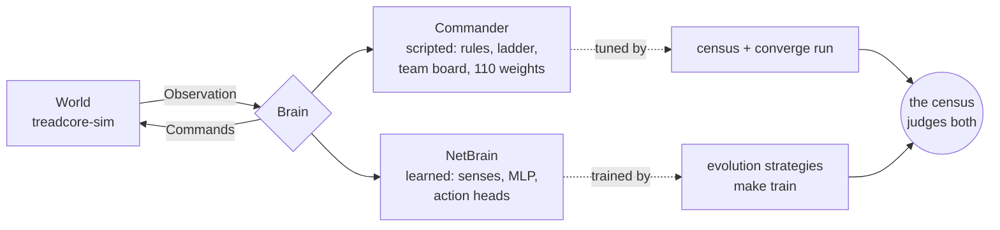
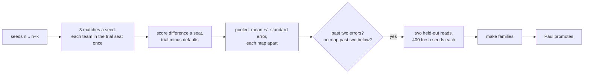
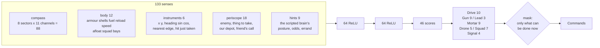
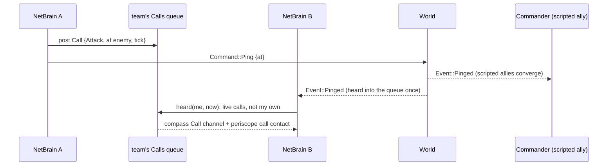
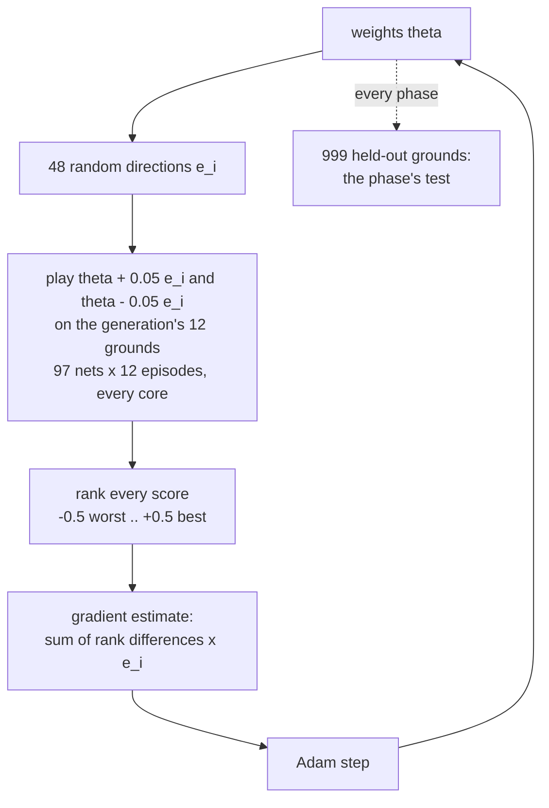

# The AI Brainz Plan

How treadcore's tanks think today, how a learned tank is being taught to
think, how the two are compared, and what comes next. Paul Richeson,
with Claude, 26 October 2026. The record of each step is
`LAB-REPORT-BRAIN.md` (sections cited as LR n); the code map is
`BRAIN-MAP.md`; how a reading is made is `CENSUS.md`.

Contents: 1. The two brains at a glance. 2. The scripted brain. 3. The
census: how any brain is judged. 4. The learned tank: senses, net,
heads. 5. Calls to friends: a shared request queue. 6. Training:
generations on the CPUs. 7. What has been proven. 8. Proposed
upgrades. 9. Commands.

---

## 1. The two brains at a glance

Every seat in a match is driven by a `Brain` (`treadcore-brain`): each
tick it is given an `Observation` (what that seat can see) and returns
`Command`s, validated by the world exactly as a player's keys are. Two
kinds of brain implement it.



| | Scripted (Commander) | Learned (NetBrain) |
| --- | --- | --- |
| What it is | about 18,000 lines of rules: a ladder of rungs, postures, a team board, tactics | 15,791 numbers in a three-layer net |
| What it reads | the whole `Observation`, worked into facts, memories and an influence map | 133 senses: a compass, the body, instruments, a periscope, calls |
| Where its judgement lives | 110 named weights in `weights.rs`, each a scalar the census can move | the net's weights, moved by evolution |
| How it improves | a census per change; `make converge` suggests and reads trials | `make train`, a phase at a time, each gated by a held-out test |
| Speed | the census's whole cost, 2.6 to 3 times faster since LR 91 | 7.8 us a decision (senses and forward pass) |
| Can do | everything: supply, capture, fortify, bridges, drones, teams | so far: drive to an enemy, a depot or a pillbox, and shoot an enemy |

---

## 2. The scripted brain

The Commander (`commander.rs`) is a Brain for a seat with a goal. On
Auto it climbs a ladder, top down, every tick; the first rung whose
condition holds is what the tank does:

```mermaid
flowchart TD
    A[think: Observation] --> L{low on shells<br/>or armour?}
    L -- yes --> H[go home, resupply]
    L -- no --> R1{hostile at the base?}
    R1 -- yes --> D[defend base]
    R1 -- no --> R2{castle not standing?}
    R2 -- yes --> F[fortify]
    R2 -- no --> R3{quiet, pillboxes outlying?}
    R3 -- yes --> T[turrets: bring them home]
    R3 -- no --> R4{pillbox to take near?}
    R4 -- yes --> HU[hunt]
    R4 -- no --> R5{depot to take?}
    R5 -- yes --> EX[expand]
    R5 -- no --> G[guard]
    subgraph every tick, beside the ladder
      DO[the dodge: out from under a shell<br/>dodge_horizon 2 s]
      TA[tactics: whom to shoot, kite, flank]
      BO[the team board: influence, front,<br/>posture, jobs, rotation]
    end
```

The team board (`board.rs`) is shared by a team's Commanders: an
influence map of 16 by 16 sectors, the front where it changes sign,
the team's posture (economy, fortify, connect, expand, defend), and
the jobs handed out. A posture leans the ladder toward its rungs by a
weight. Every either/or in it is a scalar in `weights.rs` (110 of
them) with a Caps switch, so the census can find the value.

Its strength is breadth: it plays the whole game. Its weakness is that
every behaviour is hand-written and every number hand-started; the
census can only tune what is already written.

---

## 3. The census: how any brain is judged



A census plays sixteen seats (three teams of five and a loner) on every
map, the trial weights (or a team of nets, `CENSUS_NET`) in one team's
seats against the defaults in the others, each team taking the trial
seat once a seed. Its reading is the difference a seat with its
standard error. One machine's matches are never pooled with another's
(the sim is deterministic per machine, not across architectures).

`make converge` runs it as a learner: a ledger of every census, a
response-surface fit of each weight (weighted least squares on the
log of the value, a ridge), Thompson samples and the fit's best as
the next generation's trials, any trial past two errors read twice
more on 400 fresh seeds. On 26 October it found dodge_horizon 2 on its
own and read it held out ten times (+1.09 to +2.66, each past two
errors); it is the default now (LR 97).

**The same census judges a net.** A team of `NetBrain`s sits in the
trial seat exactly as a weight change does, so the learned tank and
the scripted one are compared on one scale, on the same seeds.

---

## 4. The learned tank: senses, net, heads

The idea is Paul's: the tank does not read the world's lists; it has
instruments, as a tank commander has a periscope and a submarine a
plot. Every sense is a number from 0 to 1 (the periscope's bearings
-1 to 1), the same count on every map.



**The compass** (radar, in the round). Eight sectors round the tank,
relative to its heading (0 ahead, 2 right, 4 behind, 6 left), each with
eleven channels; a channel is the strongest thing of its kind in that
sector, `1 / (1 + d / 8)` for one `d` tiles off:

| Channel | Like |
| --- | --- |
| hostile tank (weaker when hurt) | the gunner's sight |
| allied tank | the IFF light |
| hostile pillbox (1 inside its reach) | a threat warning |
| neutral pillbox, our pillbox | the map |
| depot to take, our depot | the map |
| shell coming (sooner and nearer stronger) | a missile-approach warner |
| ground (how soon the way is blocked) | a depth sounder, a ray 16 tiles out |
| cover (forest near) | the driver's eye |
| a friend's call | the radio |

**The instruments** (navigation): where on the map (x, y as shares of
the map), which way it faces (sine and cosine), how near an edge, and
a hit just taken (1 as it lands, gone in 2 s): the tank's GPS, gyro
compass and hull-hit light.

**The periscope** (a submarine's plot of contacts). The compass says
"something in the right-front eighth"; the periscope gives the exact
bearing of the four contacts that matter most:

| Contact | Numbers |
| --- | --- |
| nearest hostile tank | bearing sine (right +), cosine (ahead +), strength, closing speed (0.5 still, 1 closing at top speed), aspect (1 pointing at me), in the gun's reach |
| nearest thing to take (depot, neutral or dead pillbox) | bearing sine, cosine, strength |
| nearest depot of ours (supply) | bearing sine, cosine, strength |
| a friend's newest call | bearing sine, cosine, strength (fading), its kind (help, attack, take) |

The periscope was the difference in training: with the compass alone
the net needed 500 generations to reach a pillbox 95% of the time;
with the periscope it passed every ground by generation 67 (LR 97).

**Why these and not more.** Each is a few comparisons over lists the
observation already holds, so the senses cost under 8 us with the net
(phase 0). They are local and relative, so a net trained on one map
reads any map. What is left out on purpose: raw positions of every
entity (a different count each match), the map's tiles (a picture
would need a convolution and a GPU), and anything a tank in the field
could not know.

**The heads.** The net's 46 outputs are scores for seven heads; in
each the highest-scoring choice allowed now is taken (a mask: no shot
without shells or a target in reach; a call only every 2 s). Drive: a
sector to drive 6 tiles toward, stop, or hold. Gun: a sector's nearest
enemy, aimed by the Lead head (where it is, where it will be, between).
Mortar: a sector's enemy in indirect reach. Signal: a call to friends.
Drone and Squad are held until their phases.

---

## 5. Calls to friends: a shared request queue



A team's learned tanks share one `Calls` queue (`calls.rs`), one a
match, as a team board is shared. A call is a kind, a place and a
tick:

| Call | Means | Points at |
| --- | --- | --- |
| Help | come to me | the caller |
| Attack | go for that enemy | the nearest hostile tank, else a live hostile pillbox |
| Take | take that | the nearest depot or neutral pillbox to take |

A call lives 10 s; the queue keeps the newest 16; a tank calls at
most every 2 s. Each call is also said in the world as a `Ping`, so
scripted teammates answer it as they answer one another, and a
teammate's ping heard in the world comes into the queue as an attack
call: nets and scripted brains share one language. Brains think in
seat order on one thread, so the queue is the same every replay.

---

## 6. Training: generations on the CPUs



Evolution strategies (Salimans and others, 2017): no gradients through
the game, every episode its own, so 24 threads (or any machine added)
are filled. A training ground (`learn.rs`) is one tank on a square of
grass 49 tiles wide, the target 10 to 20 tiles off in a direction the
seed draws: an enemy tank, a neutral depot or a neutral pillbox in
turn. An episode is 60 s at most.

| Phase | Reward | Test (written before training) |
| --- | --- | --- |
| 1. Go to | the share of the way closed (a potential: no pay for circling), +1 for reaching within 3 tiles, up to +0.5 the sooner | within 3 tiles inside 60 s on 95% of 999 held-out grounds, each kind |
| 3. Drive and shoot | an enemy: +1 a direct hit, -0.05 a miss or a lobbed shell, up to +0.2 for closing; a depot or pillbox: phase 1's | a direct hit on the enemy, the depot and pillbox reached, each on 95% |

---

## 7. What has been proven

| Read | Result |
| --- | --- |
| Phase 0: a random team in the census, 110 seeds | -19.30 +/- 0.36 (LR 96) |
| Phase 1, first senses (101), 500 generations | enemy 99.7%, depot 100%, pillbox 95.2% of 999 |
| Untrained net, new senses (133), phase 1 grounds | enemy 13.2%, depot 1.8%, pillbox 0.3% |
| Phase 1, new senses, 500 generations (130 s on an M1) | 999 of 999 |
| Phase 3, shoot only, from phase 1 | a direct hit on 999 of 999, 0 lobbed; but forgot the going (depot 9.3%, pillbox 23.7%) |
| Phase 3, drive and shoot, all three grounds, 400 generations | enemy shot 333 of 333 (3 direct hits each, killed), depot 333 of 333, pillbox 333 of 333 |
| A team of the phase 3 net in the census, 110 seeds | **-23.52 +/- 0.38**, against a random net of its shape -20.35 +/- 0.25: worse by 3.17 +/- 0.45 |

The last row is the plan's most useful result. On the grounds the net
drives straight at its target and nothing shoots back; in a match the
nearest target is often a hostile pillbox or a team of five, and it
goes down faster than a net that wanders. A skill trained on a clean
ground does not carry into a match until the ground also teaches what
kills. So upgrade 1 below is now *live* (phase 4 and hostile ground),
ahead of a moving target.

---

## 8. Proposed upgrades

In the order they would be done; each is a phase of LR 95 with its
test written first.

| # | Upgrade | Why | Test |
| --- | --- | --- | --- |
| 1 | **Phase 4: live.** Grounds with a hostile pillbox, an enemy that fires back, shells landing; the reward loses armour and pays for a target taken alive | the census shows the drive-and-shoot net dying for its targets (LR 97) | the dodge's families' floors (99%), then a census above the random team |
| 2 | **Phase 3b: a moving target**, then one that shoots back | a still tank is never missed; lead matters only on a mover | hits a shot at least the scripted aim's on the same grounds |
| 3 | **Phase 2: go round** water, walls and forest on the real maps | the grounds are open grass; the census's maps are not | 90% within 3 tiles on prior-art maps |
| 4 | **Phase 5: duel** the scripted brain at skill 0.3, 0.6, 1 | the first ground where the opponent thinks | half the duels won at each |
| 5 | **Calls trained**: two nets on a ground where one sees the enemy and one does not | the queue exists; nothing yet rewards using it | the blind one arrives sooner than alone |
| 6 | **Hints on, then off**: the scripted brain's posture and errand as senses, faded out over training | a teacher's conclusions shorten the search | the census with the hints at zero |
| 7 | **Behaviour cloning, then PPO, on the 4060 Ti** (Burn, CUDA) for phases 5 to 8 | full matches are slow for evolution | the census, every map, two held-out reads |
| 8 | **A league**: nets against earlier nets and the scripted personalities | a net trained against one opponent overfits it | Elo from the ledger |
| 9 | **The census as judge of every net**: `CENSUS_NET` each phase | one scale for scripted and learned | the usual rule |

What stays: the scripted brain is the game's brain until a net beats
it by the census's own rule; the census is the only judge; every step
is written down before it is run.

---

## 9. Commands

```sh
make train PHASE=1                      # train going to, 200 generations (GENS=)
make train PHASE=3 START=nets/phase1.bin GENS=400   # drive and shoot, from phase 1
make train PHASE=3 CHECK=nets/phase3.bin            # read a net on the 999 held-out grounds
make train PHASE=3 GENS=0 BASELINE=rulebot          # the scripted bot on the same grounds
CENSUS_NET=nets/phase3.bin SEEDS=110 make census    # a team of nets against the defaults
make converge                                       # the scripted brain's weights, until stopped
```

Settings for `make train`: `GENS`, `PAIRS` (48), `SEEDS` (12 grounds a
generation), `THREADS` (all), `START` (a net to begin from), `OUT`
(`build/train`), `HELD` (999). A net is a file: the magic `TCNET1`,
the layer sizes, then every weight, little-endian (`net.rs`).
