# How to play treadcore

The player's guide, for someone sitting down to the window for the
first time. Every picture here is taken by `make shoot` from the same
scripted match, so what you see is the build this guide ships with
(`RELEASE.md` section 6). The game's rules and numbers are in
`DESIGN.md`; the screen's reasons in `INTERFACE.md`.

## 1. Start

```
make configure
make run                 # solo: you against fifteen bots
PLAYERS=4 make run       # against three
ROOKIES=15 make run      # against fifteen bots that play badly: start here
make lan                 # a LAN game: waits for peers, elects a host
```

Or `make install`, which puts Treadcore in your desktop's application
menu (on Copal, Super+Space, under Games). If the window's system
packages are missing, `make deps` says what to install for your
distribution.

Or, from crates.io, `cargo install treadcore-client` puts the window
on your path as `treadcore`; `treadcore --solo` starts the same solo
match. The headless server is `cargo install treadcore-server`.

The window opens on a lobby screen, then the match. You are one tank
on an island of 128 by 128 tiles with up to fifteen others. Last tank
standing wins; at the time limit, the highest score.

**The first minute is yours.** For the first sixty seconds the bots
hold fire at a tank that has not moved and has not fired, so you can
sit at the start and read this. The moment you drive or shoot, you
have begun, and so have they. After the minute, a tank that stands
still is found: move after you fire.

**Rookies for a first match.** `ROOKIES=n make run` (or `treadcore
--solo --rookies n`) makes the first n bots rookies: no drones for a
minute and a half and one interceptor after, shells that land a few
tiles off and never lead you, and no storming of your depot. They
still fight; they fight slowly. Lower the number as you win.

**Again.** When a solo match ends, the screen gives the scores, your
kills and deaths, and how many rounds you have won of how many played.
**Enter** plays again: the same island and seats, the bots reseeded so
they do not open the same way twice. Esc leaves. Over a network,
Enter takes you back to the lobby on the same port: whoever presses
Enter within twenty seconds of you meets you there, a host is elected
again, and the next match begins. A lost connection offers the same.

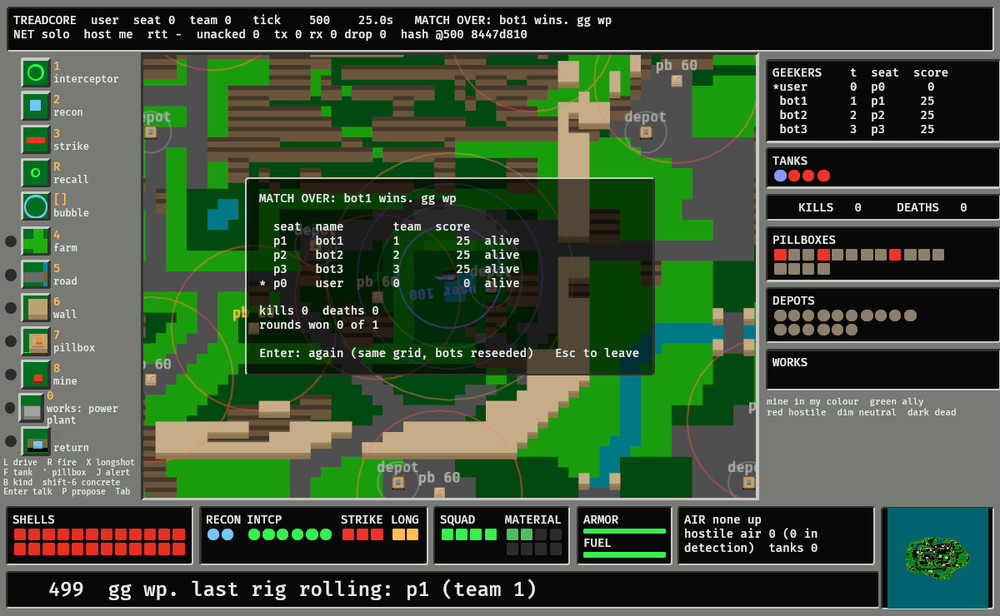

## 2. The screen

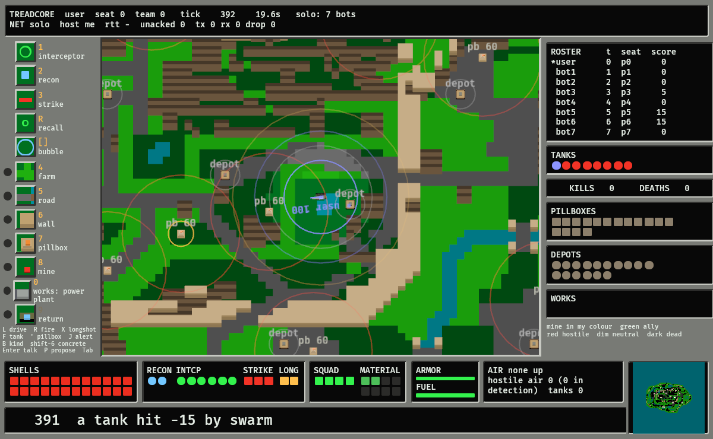

The layout is the prior art's (Bolo's, `INTERFACE.md`): orders down
the left, the map in the middle with your tank at its centre, the
state of everyone and everything down the right, your tank's stock
along the bottom, and one line of news under it all. Nothing is ever
drawn over the map unless you ask for it.

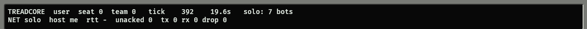

The top strip says who you are and which seat, the tick and the
seconds, and how the network is doing. It goes red, with `UNDER
FIRE`, for three seconds after a hit lands on you.

## 3. Driving and firing

The mouse drives and fires; the keys give orders.

- **Left click** on the map drives there. The world routes you round
  water, over bridges and round hostile pillboxes; the line from your
  tank shows the leg in progress and, fainter, the rest of the route.
- **Hold the right button** and the gun's reach lights: the two
  orange rings are the indirect gun's minimum and maximum (12 to 60
  tiles), the white one is direct fire's reach (10 tiles). Release to
  fire where the cursor is. Inside the white ring with a clear line
  you fire direct; otherwise the shell is lobbed, six seconds in the
  air at full range, and lands within four tiles of the point unless a
  recon drone can see it, when it lands within one.

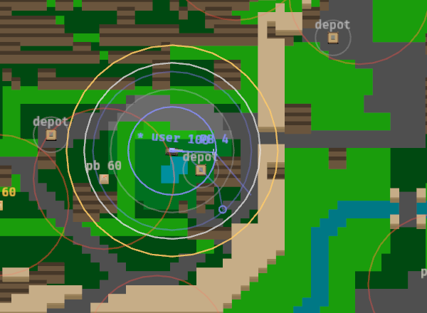

A hit on you flashes the map's frame red and shakes the view for a
moment. Watch the newswire for what hit you and what is left.

- **Space** stops. **F** puts the view back on the
  tank; **W A S D** or the arrows scroll it away. The wheel zooms.

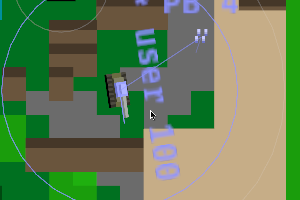

Up close every thing on the map is a stack of small cubes: the tank's
hull and turret, a pillbox's stepped pyramid with its gun, a depot's
plate. Damage chips cubes off them, and a shell throws loose cubes
out of whatever it hits, so the state of a thing is readable from its
shape.

## 4. The orders column

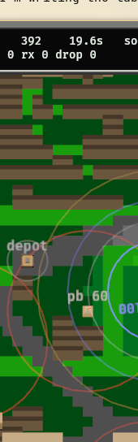

Each tile is a picture of what the order makes, with its key and its
name beside it. The key is lit amber when the order can be given and
dim when it cannot (no drone left in the bay, the squad out, no
material). Click the tile or press the key; they are the same.

**The drones** (the top five). Your tank carries a bay of drones.

| key | order | what happens |
| --- | --- | --- |
| `1` | interceptor | launches one to hold station on the *bubble*, the ring round your tank, and ram any strike drone that flies in. One shot each. |
| `2` | recon | launches one to orbit the point under the cursor. It sees 12 tiles and feeds the gun: a shell at a target the recon can see lands within 0.6 tiles. |
| `3` | strike | launches the FPV at the nearest hostile tank to the cursor: it flies there and dives, 35 of 100 armor if it gets through the target's bubble. |
| `R` | recall | brings every drone home to the bay. |
| `[` `]` | bubble | shrinks or widens the ring: wide catches strikes early but thins the ring and stretches every link. |
| `X` | longshot | (no tile) sends the long-range drone at the point under the cursor, anywhere on the map. It is slow, it flies on its own and it does not come back; section 6b. |

The bay refills at a depot. The lamps along the bottom (RECON, INTCP,
STRIKE, LONG) show what is left in it.

## 5. The builder: the Pillboys

A squad of four rides with the tank. They take the ground: they fell
forest for material, lay roads, raise walls, build and repair and
capture pillboxes, and bury mines. Their orders are the five *modes*
in the column's lower half, in the order the prior art had them.

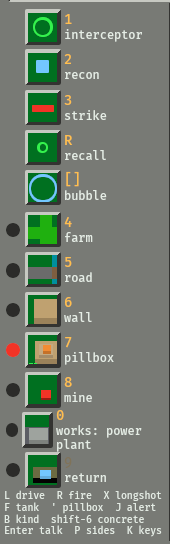

1. **Arm a mode**: press its key or click its tile. The red lamp
   beside it is the one lamp lit in the column, so the mode is never
   in doubt. Press it again, or Esc, to drop it.
2. **Click the square.** The square under the cursor is outlined in
   the colour of what the squad would make there. The click sends
   them; the mode drops as they go, because they take one order at a
   time.

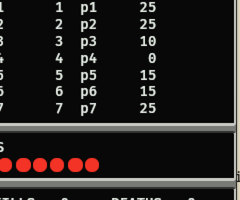

| key | mode | on the square |
| --- | --- | --- |
| `4` | farm | fells the forest there: four material a tile, in four seconds. Only on forest. |
| `5` | road | lays a road; on water, a bridge. |
| `6` | wall | raises a wall three levels high. Blocks tanks, shots and a pillbox's line of fire; a shell's splash knocks it to rubble. Armed with Shift held (or clicked with Shift), it pours **concrete** instead: two material, pale grey, and a splash only cracks it to a plain wall, so it takes two. |
| `7` | pillbox | on open ground, builds one. On a pillbox: repairs it, whoever owns it; if it is dead or nobody's, captures it (ten seconds standing on it). |
| `8` | mine | buries a mine. Hidden until found; set off by a tank, a shell or a neighbouring mine; ignored by drones. |
| `0` | works | on a pad (the dark grey foundations), builds the structure the row names; `B` steps the kind. On a structure: mends ours, or takes one that is nobody's or wrecked. Section 6b. |
| `9` | return | brings the squad home. |


The SQUAD lamps along the bottom are green while the four are aboard
and amber while they are out; MATERIAL counts what they carry, eight
at most. A squad outside the tank can be killed by a shell or a mine
blast, and comes back one man at a time at a depot.

An order the world will not take is refused, and the refusal stays on
the newswire for four seconds, or until your next order, so you can
read why:


Every refusal carries a tag in front of it, the names a helpdesk has
for the fault that is not in the machine. They are a joke at the
chair's expense, never at yours: the line after the tag says what is
wrong with the order, and the scrollback (Tab) spells the tag out.

| tag | spelled out | what it covers |
| --- | --- | --- |
| `60 CM` | the error is 60 centimetres in front of the screen | aiming: inside minimum range, beyond range, no line of sight, off the map |
| `PICNIC` | Problem In Chair, Not In Computer | the world working as made: water, a tile already taken, a pillbox still alive, a structure off a pad |
| `PEBKAC` | Problem Exists Between Keyboard And Chair | what the lamps already said: no shells, reloading, no material, the bay empty, the squad out |
| `LOOSE NUT` | a loose nut behind the keyboard | the order went to the wrong thing, or one that is gone |
| `KB-TO-CHAIR` | a keyboard-to-chair interface fault | talking and treaties: one message a second, the three-way rule |
| `ID-10-T` | an ID-10-T error | the command line: a flag, a number or a file that wants a second look |

When something that was down comes back by itself (a structure's power
after its plant is mended or retaken, a dropped seat that returns),
the newswire or the host's log says so the helpdesk way: "We're back
up." "Well, it's working now. That's the main thing."

## 6. Pillboxes and depots

Twenty neutral pillboxes start on the map and shoot anyone within
eight tiles, tanks and drones both. Shoot one dead (its pyramid
loses its gun and its top steps as its health goes), then send the
squad in pillbox mode to capture it; it then shoots for you and holds
shells for your tank. Depots resupply and repair a tank standing on
them; stand on a neutral one for ten seconds and it is yours.

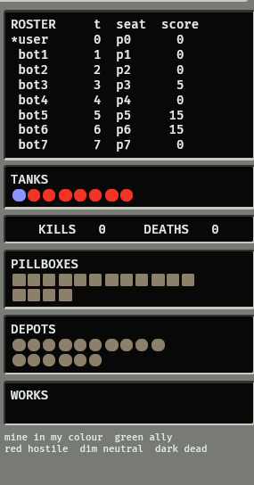

The right column is the state of everyone: the roster with team, seat
and score; a round lamp per tank; your kills and deaths; a square lamp
per pillbox and a round one per depot, each in its owner's colour
(yours in your seat's colour, green an ally's, red hostile, dim
neutral, dark dead). **Click a pillbox lamp** and the view jumps to
that pillbox; the **apostrophe** steps through your own and your
allies' pillboxes, and in that view the **arrow keys** jump to the
neighbouring pillbox in that direction. **F** comes back to the
tank.

**Taking one, by the numbers.** A pillbox has 60 health and reaches
8 tiles. Your direct gun reaches 10 and does 45. So stop between 8
and 10 tiles from it, with a clear line, and two shots kill it while
it cannot touch you; then press `7`, click it, and the squad stands on
it for ten seconds. A pillbox never shoots at the squad. A neutral
pillbox does not have to be shot at all: keep the tank outside its
eight tiles and send the squad to take it live. Or let the tank do
it: press **G** (section 6d).

## 6b. Industry, and losing it

Some maps have an economy: dark grey **pads** of foundations with
**structures** on them (`INDUSTRY=1` gives the generated island one;
the world maps have their own). A structure is taken as a pillbox is,
by the squad standing on it while it is nobody's or wrecked, and it
works for your side while it stands:

| structure | what it does for your side | needs power |
| --- | --- | --- |
| power plant | powers your side's structures within 18 tiles | no |
| refinery | your tanks burn half the fuel; within 3 tiles, fuel and shells | yes |
| data centre | a blind shell aimed within 40 tiles scatters half as far; hostile drones within 30 tiles are on your screen | yes |
| workshop | within 3 tiles, armour mended twice as fast as at a depot and the bay restocked, longshots first; pillboxes and structures within 8 mend slowly | yes |
| jammer | no drone within 7 tiles keeps its link, **yours included**: recon and strikes turn for home, a longshot lands off its point | yes |

Every standing structure scores its owner two points every ten
seconds, so at the time limit the side with the economy is ahead. A
structure has twice a pillbox's health, so a shell takes a while; a
**longshot** (`X`) takes two thirds of it at once. The longshot is the
cheap one-way drone that crosses the map: slow (three tiles a second),
on its own from launch, so no recall and no new target, and it goes on
if your tank dies. Interceptors and pillboxes shoot it down like a
strike, so a parked tank and a ring of pillboxes defend a refinery.
Nothing defends all of them. Wreck a power plant and everything it
powered goes dark without being touched.

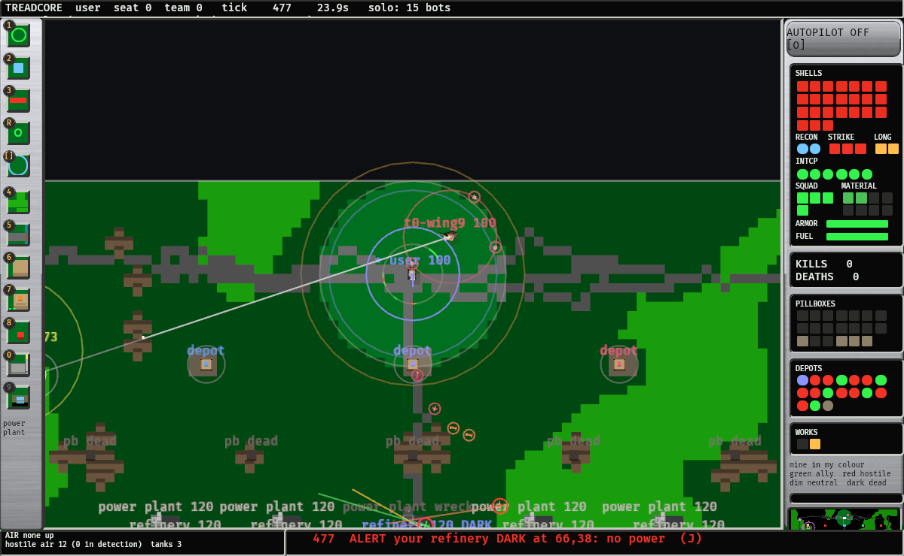

The structures on the map are labelled with their name and health,
and DARK when they have no power. Whatever of your side is hit,
wrecked, taken or goes dark is an **alert**: a line on the newswire
in red, saying what and where, held there five seconds over whatever
comes after it, with the alarm and a red blink on the minimap. **J**
jumps the view to the newest alert.

The **WORKS** row in the right column is your side's structures, one
lamp each, yours first: your colour (an ally's green) while it works,
amber when it has no power, red under half its health, dark wrecked.
Over eight seats the column folds the tank lamps away and sets the
roster smaller, so the depots and the works still fit.

The **minimap** at the right of the bottom strip is the whole map:
the ground dimmed where your side cannot see, every depot, pillbox
and structure in its owner's colour, the tanks you can see, your own
in white. Click it, or hold the button and drag, to move the view.

## 6c. Tank speak

The newswire and the bots talk like a crew that has been at it all
night: cyberpunk, a little l33t, with the FPV pilots' words for the
flies and some of the old tank crews' for the rig. The people at the
controls are **geekers**. Kills, launches, lost flies, jamming, the
end of a match and the bots' calls are said several ways; which way
is picked by the event's own number, never by the world's dice, so a
match plays the same whatever is said in it. The words:

| tank speak | plain |
| --- | --- |
| geeker | a player, at the controls |
| rig, pigiron | a tank |
| slugs | shells |
| flies | drones |
| whoop | an interceptor: small, ducted, in the bubble |
| toothpick | a recon: ultra-light, eyes only |
| kami | a strike drone: one way, into a rig |
| loiter, loitering munition | a longshot: slow, far, one way, at a fixed point |
| grunts | the squad of pillboys |
| scrap | material |
| pack | a fly's battery |
| fuzz | a jammer, and what it does to a link |
| the grid | the map and the economy on it |
| kill-zone | the ground inside the enemy's flies' reach |
| cost-exchange ratio | a cheap loiter against a refinery: why the economy is the target |
| send it, rip it | commit: launch, fire, go in |
| punch out, WOT | full throttle, all at once (wide open throttle) |
| gap, shoot the gap | a tight way through, threaded |
| on the way, shot over | the artillery's calls: a slug is in the air |
| Power! | the gun is about to move: the old tank crews' warning |
| jello, ghosting | a feed shaking apart, or two feeds over each other: a link going, or jammed |
| LQ | link quality: the % beside a fly in the air line |
| failsafed, RTH | the link is gone and the fly returns to home |
| browned out | the pack sagged flat in the air |
| pancaked | shot down, flat |
| magic smoke | what comes out of a fly caught in a blast |
| VTX, VRX | the fly's video transmitter, the rig's receiver: the link |
| OSD | the on-screen display: the frame around the map |
| rekt, pwned, fragged, uninstalled | destroyed |
| bite the dust | destroyed, the old way |
| going in hot | storming a depot |
| bolo crew | a crew that fails gunnery: the rookies |
| meatware, wetware | the geeker, as opposed to the rig |
| rig's green | it works again |
| tanker ears | what the M key spares |
| dronovod | a drone operator: a geeker flying |
| spotter | whoever watches for the geeker: a recon's job |
| disarm, disarm! | what is shouted when a fly goes down near its own rig |
| gl hf | good luck, have fun: a match begins |
| gg wp | good game, well played: a match ends |

Slang aimed at people (a good deal of real crew slang is) is left out
on purpose: the voice is gg and gl hf, and the joke is never at a
geeker's expense.

## 6d. Goals: commanding instead of driving

**G** steps the tank's goal, and the top strip says the goal and what
the tank is doing for it:

1. **hunt pillboxes**: the nearest pillbox not of your side. A live
   enemy one is shot dead from the ring between 8 and 10 tiles (if a
   wall or trees block the line, the tank moves round it to find
   one), then the squad takes it; a neutral one the squad takes live.
   Then the next.
2. **defend depot**: the nearest depot of your side. The tank stays
   on it, shoots what comes within twelve tiles, and has the squad
   mend the depot's pillbox.
3. **defend pillbox**: the same about the nearest pillbox of yours,
   and the squad takes it back if it falls.
4. **hold**: the same about the spot where you pressed G.
5. **escort**, when an ally's tank is in sight: the wingman goal
   below, following that ally.

Then back to the wheel. A click to drive or Space takes the wheel back
at once. Under every goal the tank keeps its drones up as a bot
would, and goes home to a depot when its shells or armour run low.

**Wingmen.** `--wingmen N` (`WINGMEN=n make run`) makes the first N
bots wingmen: each follows you, asks to join your side (`Y` lets it
in), and in this order covers you from a tank within ten tiles of
you, hits what is ahead of you, takes the pillboxes within sixteen
tiles of you, takes a depot near you, helps another ally's fight, and
otherwise closes up behind you. It never goes more than twenty tiles
from you. It answers yes to a proposal from you or your side, and to
anyone who has not shot at it. It leaves your side only once every
pillbox and every depot on the map has been the side's for ten
seconds, and takes what it captured with it.

## 7. The stock

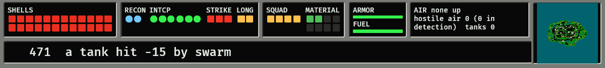

Along the bottom: 24 shells as red lamps; the bay by kind; the squad
and its material; armor and fuel as bars; and the air table, which
lists every drone of yours in the air with its link to the tank and
its battery, and what hostile air is in your detection ring. A link
goes green to red with distance; a drone on a dead link flies on its
own judgement.

## 8. What happened

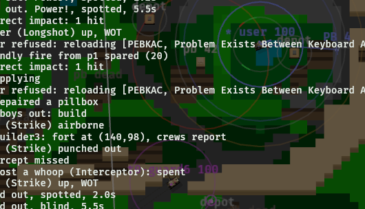

The newswire shows the last thing that happened. **Tab** opens the
scrollback over the map: the last forty events, each stamped with its
tick. Tab again closes it.

**Enter** opens a line on the newswire to everyone, **Shift-Enter**
one to your team, and **Tab** steps everyone, your team, and the
tanks nearby (within fifteen tiles of yours) while you type. Start the
line with **@name** to say it to chosen players only: `@west @p5 meet
me at the depot` (a name, the start of one, or a seat). The prompt
says who will hear it and how many; for "nearby" it counts the tanks
you can see, and the world may find one more in the fog. Enter sends;
Esc puts the line away. While it is open your keys are
the line's (the mouse still drives). A message from another player
stays on the newswire for eight seconds under their name, with a soft
tone. One message a second: send again too soon and the line waits,
marked, for Enter once more.

What you cannot see you can hear. Your gun's blast and the boom where
it lands, the crack of direct fire and the ring of a round striking
armour, a drone leaving the bay, a strike drone's whoosh, a tank going
up, a pillbox firing, each from where it happened. Anything on screen
is at full strength, left or right as it lies; off screen it fades
with the distance and dulls, so the whole map is a rumble in the
background on the side it is on. Your own tank is a machine you can
hear: the breech working after each shot, the loader at a depot, a
clock ticking while you take something, a long beep when you fire
with no shells left, an alarm when your armour is low, and the tracks
as you move. A hostile shell
whistles where it will land as soon as you know of it, which is the
warning the screen cannot give for a gun you have not spotted. A
capture, a loss, the swarm, a refused order and the end of the match
have a short tone each. **M** turns the sound off and on; `--mute`
starts with it off.

## 9. Sides

Everyone starts on a side (with `TEAMS`, a side of several; without,
a side of one), and sides change by proposal. **P** opens the list of
everyone not on your side. Up and down pick a player, left and right
pick what you propose:

- **Join**: you join their side.
- **Recruit**: they join yours.
- **Swap**: you take their side and they take yours.
- **Merge**: your whole side joins theirs.

The list says what it would do, and whether the world would refuse
it. The world keeps three sides alive at least, and lets no side hold
more than half the tanks, so not every proposal can stand. Enter
proposes; it stands thirty seconds. **L** in the list leaves your
side; Esc or P closes it.

A proposal to you or your side stands on the newswire with its
seconds left: **Y** accepts, **N** turns it down. Anyone on the side
asked may answer. Every proposal and its end is public: a betrayal is
news the moment it happens. A bot answers a person: yes, unless that
person has shot it.

## 10. Keys, all of them

These are the defaults. **K** opens Key Setup over the map: up and
down pick an action, Enter waits for its new key, Delete puts every
key back, K or Esc closes and saves. A key another action had is
swapped onto it, so every action keeps exactly one key. Alt, Print
Screen and Pause are never bound, nor Esc, Enter, the arrows and
Shift, which the menus, the chat line and concrete need. The bindings
are kept in `~/.config/treadcore/keys` (or `--keys FILE`), one
`action = key` a line, and a key is its place on the keyboard: on
AZERTY the scroll keys are still the four under your left hand. The
orders column and the hints under it show your keys, not these.

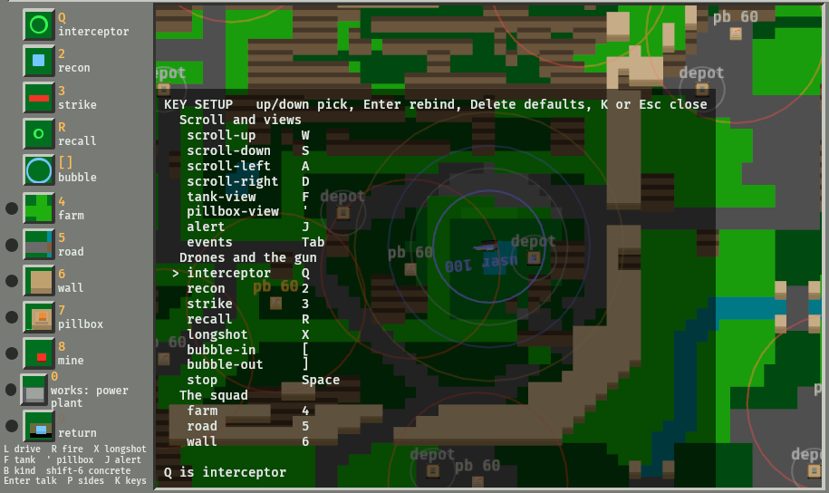

| key | does |
| --- | --- |
| left click | drive there (and take the wheel back from a goal); with a builder mode armed, send the squad there |
| right button, held and released | aim, then fire where the cursor is |
| `1` `2` `3` | launch interceptor, recon (to the cursor), strike (at the nearest hostile to the cursor) |
| `R` | recall every drone |
| `[` `]` | bubble narrower, wider |
| `4` `5` `6` `7` `8` `0` | arm farm, road, wall, pillbox, mine, works |
| Shift-`6`, or Shift-click in wall mode | concrete instead of a wall |
| `B` | the next kind of structure for the works mode |
| `X` | a longshot at the point under the cursor |
| `J` | the view to the newest alert |
| click the minimap | the view there |
| `9` | the squad home |
| Esc | drop the armed mode; with none armed, quit |
| Space | stop; also takes the wheel back from a goal |
| `G` | the next goal: hunt pillboxes, defend depot, defend pillbox, hold, escort, the wheel |
| `F` | the view back on the tank |
| Enter | talk to everyone: type, Enter sends, Esc puts it away |
| Shift-Enter | talk to your team (Tab steps all, team, nearby; `@name` chooses players) |
| P | the proposal list: up/down who, left/right what, Enter proposes, L leaves your side |
| Y, N | accept or turn down the proposal on the newswire |
| `W A S D`, arrows | scroll; in pillbox view the arrows jump between pillboxes |
| `'` | pillbox view: the next of yours |
| wheel | zoom |
| Tab | the events scrollback |
| M | sound off and on |
| K | Key Setup: rebind any of the keys above |

## 11. Over a network

`make lan` on each machine: the windows find each other on the LAN,
measure the links between them, and elect a host among themselves;
nobody runs a server. Across the Internet one machine runs `make
introduce` and the others point at it with `INTRODUCER=host:port`.
A player whose game drops starts it again and gets the same seat
back. A group that has a machine always on can run `make listen`
there: a server that sits in the lobby, takes no seat, and hosts
whenever its links are as good as anyone's (within 10 ms of the best
player's), match after match, keeping every match's trace and replay
and showing what it is doing at `http://that-machine:47296/`. When a
player is better placed, a player hosts, as without it. `README.md`
has the details; `PROTOCOL.md` has the reasons.

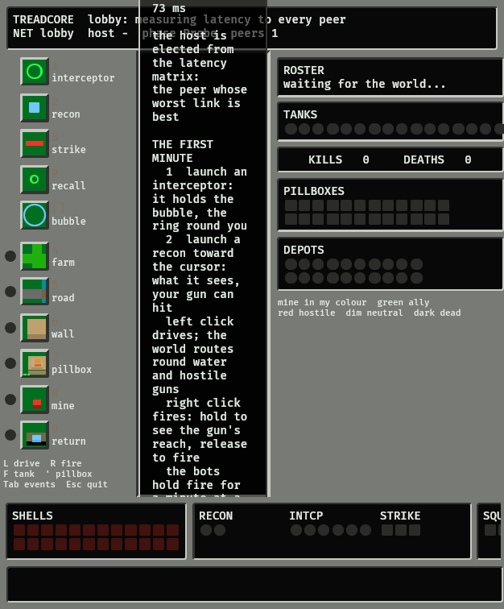

The lobby takes a few seconds: each window finds the others, measures
every link, and they all run the same election on the same numbers,
so they agree without a vote. Then the window joins the host and
waits for the world, with the first-minute help on screen. This frame
is that moment; the peers had already been found and measured.

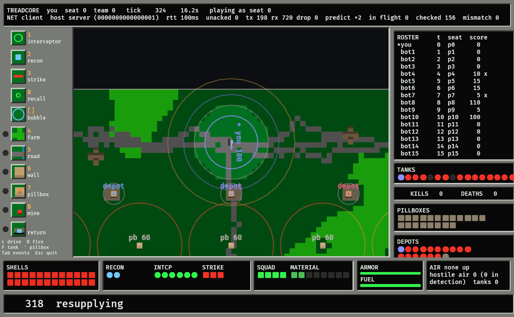

Playing as a client looks the same as playing solo, except the top
strip's second line:

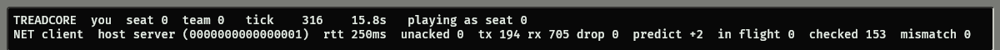

`NET client` and the host's id; `rtt`, the round trip to the host;
`unacked`, `tx`, `rx` and `drop`, the packets; and `predict`, how many
ticks ahead of the host your own tank is drawn. Your tank is
predicted, so it answers your mouse at once, and every snapshot from
the host is checked against the prediction: `checked` counts them and
`mismatch` counts the ones that disagreed, which is zero unless
something is wrong. These frames were taken on one machine with an
introducer, a headless host and a bot seat, 30 ms of simulated lag
on each link.
