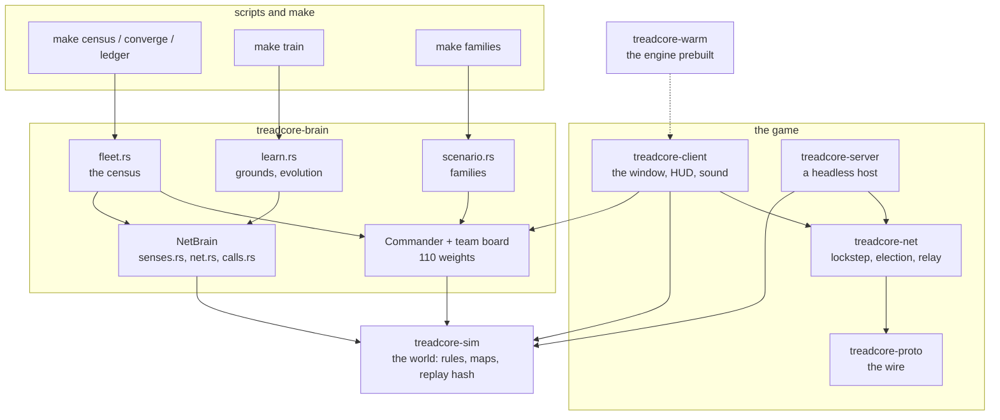

# treadcore: code structure index

An index of the repository as of commit `0874ff5` (13 October 2026),
with the step 7 additions (the introducer and rejoin, journal 0012) at
their own line numbers: the tree, an outline of every file, a glossary,
and a keyword cross-reference. Line numbers are those of those commits;
`grep -n` is the authority when they drift. The walk-through with the
reasoning is LAB-REPORT.md; this is the map.

> **Sections 1 to 3 and 5 are archived in place: the snapshot of 13
> October.** The code has grown since (the brain from one file of
> 1,158 lines to seventeen of 12,566), and they are kept as the
> development record, not refreshed. Section 4 (the documents) is kept
> current, and section 6 maps what came after the snapshot, step 12
> above all. `archive/README.md` says what else is archived.

## 1. The tree

```
Cargo.toml            workspace: seven crates in source/, one profile set
Makefile              every entry point: configure, warm, build, debug, run,
                      lan, host, seat, introduce, lobby-test, replay, map,
                      convert, test
README.md             what the game is, how to build and run it, the documents
CHANGELOG.md          what changed, by date, newest first
CONTRIBUTING.md       how to send a change
CONTRIBUTORS.md       who has
LICENSE               MIT
CNAME                 treadcore.org (the GitHub Pages domain)
index.html            the website's front page
reports/              published write-ups (2026-10-12-opening-day.html)
documentation/        the documents (section 4)
journal/              one entry per working session, RFC 822 header, IEEE
                      sections; TEMPLATE.txt and README.txt say the form
maps/                 island.map (the generated default, saved); industry.map
                      (the same with pads and structures); prior-art/ five
                      converted community maps; world/ atlantic.map and
                      europe.map (scripts/worldmap.py)
scripts/              the shell behind every make target, and the converter
source/               the crates, dependency order below
vendor/               README.md, THIRD-PARTY.md: what is taken from where
build/                configure.sh's config.env and every log (untracked)
target/               cargo's (untracked)
```

The crates, each depending only on those above it:

```
treadcore-sim      the world: map, tanks, drones, shells, squads, pillboxes,
                   depots, mines, teams, proposals; deterministic; no I/O
treadcore-proto    the wire vocabulary: one Packet enum, chunking, snapshots
treadcore-net      UDP transport, lobby and election, host and client
                   sessions, the relay route, client-side prediction,
                   the introducer (Internet rendezvous), rejoin
treadcore-brain    the Brain trait and three brains: RuleBot, Defender,
                   JsonBrain (an external program over stdin/stdout)
treadcore-server   headless binary: --local bot matches with a trace and a
                   match report, --net lobby then host or seat, --replay,
                   --introduce (the introducer)
treadcore-client   the window (Bevy): session, render, hud, input
treadcore-warm     a tiny Bevy program that exists to build the engine once
```

## 2. The source, file by file

Items are `name  line`. Private helpers are listed where they carry
a rule; tests are listed by name.

### 2.1 source/treadcore-sim/src/lib.rs (3 680 lines)

The world. Header comment: the premise, determinism, units.

| item | line | what |
| --- | --- | --- |
| `TICK_HZ`, `DT` | 37 | 20 ticks a second |
| `MAX_PLAYERS` | 41 | 16 seats |
| `EntityId`, `PlayerId`, `Tick` | 44 | u32, u8, u64 |
| `V2` | 51 | tile-space vector: `len`, `dist`, `norm`, `scale`, `lerp`, `heading`, `from_heading`, `tile` |
| `Rng` | 110 | xorshift: `next_u64`, `f32`, `range`, `below`, `disc` |
| `DroneKind` | 145 | Recon, Interceptor, Strike |
| `DroneTask` | 160 | Orbit, Intercept, Strike, Return |
| `Drone` | 172 | id, owner, kind, pos, heading, task, battery, link, tether |
| `ShellKind`, `Shell` | 192 | Indirect or Direct; `progress`, `pos_at` |
| `Bay` | 228 | counts per kind: `get`, `take`, `put` |
| `BuildKind` | 269 | Pillbox, Wall, Mine, Road: `cost`, `ticks`, `standoff` |
| `Mine` | 311 | owner, pos |
| `PillboyTask` | 323 | Capture, Repair, Build, Harvest, Return: `site`, `reach` |
| `Pillboys` | 358 | the squad: strength, material, aboard, task, route; `fresh`, `deployed` |
| `Pillbox` | 388 | owner, health, shells, reload: `alive`, `shooter`, `hostile_to` |
| `Tank` | 417 | pos, heading, speed, armor, shells, fuel, bay, goal, route, reload, bubble, last_hit_tick, alive, pillboys |
| `Tank::tick_state` | 450 | the bits prediction compares |
| `Depot` | 456 | pos, owner, capture, capturer |
| `TeamId`, `Player` | 468 | id, name, tank, alive, score, is_bot, team |
| `ChatTo`, `Terms`, `AllianceCmd`, `Proposal` | 483 | the proposal protocol's words |
| `Command` | 532 | Move, Stop, FireIndirect, FireDirect, Launch, Recall, Retask, SetBubble, Deploy, Alliance, Propose, Answer, Chat |
| `Command::predicted` | 561 | the four hull orders a client predicts |
| `Order` | 569 | player + command |
| `Event` | 578 | everything that happens in a tick (the HUD, log, bot, trace and replay read these) |
| `LossReason` | 637 | why a drone is gone |
| `MapSource` | 653 | FromScenarioSeed or Text: `build` |
| `GameType` | 672 | Open, Tournament, Strict: `shells`, `material`, `parse` |
| `Scenario` | 714 | seed, map, game_type, advantage, players, teams, swarm, time_limit; `bots`, `with_teams`, `seat_name` |
| `World` | 782 | the state; `events` is the last tick's |
| `World::new` | 809 | from a scenario: starts, depots, pillboxes, tanks |
| `map_as_played` | 891 | the map with craters and walls |
| `tank`, `tank_of`, `drone`, `pillbox` | 897 | lookups |
| `route_for` | 916 | the map's A* avoiding hostile guns and known mines |
| `mine_known_to` | 933 | own, allied, or within MINE_REVEAL |
| `team_of`, `allied`, `allied_opt`, `team_members` | 968 | sides |
| `visible_to`, `spotted_by`, `concealed`, `tank_visible_to` | 1001 | fog, spotting, forest cover |
| `step` | 1062 | one tick: proposals lapse, orders apply, then tanks, pillboys, drones, pillboxes, shells, depots, swarm, match |
| `apply` | 1092 | validates and applies one order, or rejects it with a reason |
| `apply_alliance`, `outcome`, `three_way_check`, `propose`, `answer` | 1404 | teams and the three-way rule |
| `step_pillboys` | 1547 | the squad walks, captures, repairs, builds, harvests |
| `explode_mine` | 1811 | damage, chain orthogonally, crater |
| `step_pillboxes` | 1856 | guns: tanks first, drones second |
| `step_tanks` | 1993 | every tank through `drive_tank`; mines set off |
| `predict` | 2022 | one player's tank alone (prediction) |
| `step_drones` | 2040 | orbits, links, intercepts, strikes, recovery |
| `step_shells` | 2255 | flight and impact; splash; mines cleared |
| `damage` | 2338 | armor, kills, score |
| `step_depots` | 2385 | capture, resupply, repair; contested does nothing |
| `step_swarm` | 2467 | neutral strikes from the edge |
| `step_match` | 2511 | last side standing, or the time limit |
| `hash` | 2548 | FNV-1a over the bincode of the world |
| `run` | 2555 | a world from a replay |
| `observe` | 2571 | what player p may see: `Observation` |
| `event_visible` | 2603 | which events p may know |
| `drive_tank` | 2623 | one tank's motion for one tick (host and client both) |
| `fnv1a64` | 2696 | the hash function |
| `CHECKPOINT_EVERY`, `Replay` | 2708 | scenario, orders per tick, hashes every 100: `record`, `orders_for`, `final_hash`, `verify` |
| `Observation`, `PlayerView` | 2786 | the view; `my_team`, `allied`, `my_drones`, `hostile_tanks`, `hostile_drones`, `allied_tanks`, `centre`, `clamp` |
| `wrap_angle` | 2868 | to (-pi, pi] |
| tests | 2880 | deterministic, interceptor_takes_station_and_launch_is_validated, indirect_shell_flies_and_lands, move_is_routed_across_the_river, prediction_drives_the_tank_as_the_host_does, hash_follows_state, replay_reproduces_the_world, pillbox_kills_a_tank_and_routes_bend_round_it, pillboys_capture_a_pillbox, squad_harvests_walls_and_mines, mines_chain_and_shells_clear_them, world_from_a_map_file, a_team_shares_recon_and_spares_its_own, alliances_form_and_break_and_teams_end_the_match, proposals_change_sides_under_the_three_way_rule, retask_moves_a_recon_and_recalls_one_drone, forest_block_conceals_a_tank, game_types_set_the_start, sixteen_seats, swarm_meets_bubble |

### 2.2 source/treadcore-sim/src/map.rs (790 lines)

| item | line | what |
| --- | --- | --- |
| `MAP_W`, `MAP_H` | 16 | 128 x 128 generated |
| `Terrain` | 21 | Grass, Forest, Road, Water, Bridge, Rubble, Depot, Wall: `from_u8`, `move_cost`, `passable`, `blocks_fire`, `glyph`, `from_glyph` |
| `DepotOwner`, `MapDepot`, `MapPillbox` | 71 | what a map file declares |
| `Map` | 92 | w, h, cells, starts, depots, pillboxes |
| `MapError` | 109 | line and message |
| `Map::generate` | 155 | island from a seed: noise, river, bridge, ring road, spokes, starts, depots, pillboxes |
| `crater` | 320 | a shell's mark |
| `in_tile`, `in_bounds`, `at`, `at_tile`, `move_cost`, `center` | 334 | cell access |
| `line_clear` | 360 | direct fire's line of sight |
| `set`, `tile_centre`, `forest_near` | 373 | edits and queries |
| `route`, `route_with` | 416 | A* over tiles with a danger cost, simplified to corners |
| `MAP_FORMAT`, `to_text`, `from_text` | 526 | the text file format (MAPS.md) |
| `Noise` | 694 | value noise for the generator |
| tests | 717 | generation_is_deterministic_and_starts_are_dry, map_survives_the_file_round_trip, bad_map_files_are_refused_with_a_line, every_start_can_reach_the_centre |

### 2.2b source/treadcore-sim/src/chair.rs

How a problem the player can fix is named. `Chair` (PEBKAC, PICNIC,
60 CM, LOOSE NUT, KB-TO-CHAIR, ID-10-T) with `label` and `expansion`;
`refusal` and `tagged` put a tag on a world's refusal reason (the
window's newswire, the proposal list); `usage` is a command line's
ID-10-T for stderr (server and window); `back_up` is the line for
something that works again by itself. Tests: every_refusal_has_a_name
(reads lib.rs for every reason), nobody_is_blamed.

### 2.2c source/treadcore-sim/src/lingo.rs

Tank speak: `GEEKER`, `LEXICON` (HOW-TO-PLAY 6c is made from it), the
banks (`KILLS`, `LAUNCH`, `SHOT`, `LINK_LOST`, `JAMMED`, `INTERCEPT`,
`MATCH_OVER`, `STORM`, `GREEN`) and `quip`, `lost`, `fly`, `kill`,
`match_over`; `pick` chooses by a number the caller has, never the
world's Rng. Test: tank_speak_is_varied_stable_and_friendly.

### 2.3 source/treadcore-sim/src/rules.rs (222 lines)

Every number of the game, grouped: the tank (10), the gun (37), the
drone crew (61), pillboys and pillboxes (98), mines (132), depots
(190), alliances (199), scoring (209), `SWARM_OWNER` 255 and `NEUTRAL`
254 (186, 214), `drone_speed` (216). A change here is a proposal under
GOVERNANCE.md section 5 and wants a trace.

### 2.4 source/treadcore-proto/src/lib.rs (365 lines)

| item | line | what |
| --- | --- | --- |
| `MAGIC`, `VERSION` | 27 | `TRDC`, 11 |
| `PORT`, `MAX_DATAGRAM` | 35 | 47296, 1200 bytes |
| `PeerId` | 43 | u64; for the life of a process, or of an identity file |
| `Packet` | 46 | Beacon, Hello, Ping, Pong, RttRow, Elect; Register, Introduce (the introducer); Join (with `session`), Welcome, Refuse, Command, CommandAck, Snapshot (with `acked`), Events, EventsAck, Leave, Heartbeat, Chunk; Relay |
| `Introduced` | 152 | one peer as the introducer knows it: public and local address, hosting |
| `DecodeError` | 129 | TooShort, BadMagic, Version, Body |
| `encode`, `decode`, `sender` | 148 | framing |
| `chunk_packets`, `ChunkAssembler` | 191 | a big packet in pieces (Welcome's map) |
| `snapshot_packets`, `SnapshotAssembler` | 233 | an observation in pieces, newest tick wins |
| tests | 279 | round_trip, big_packets_chunk_and_reassemble, snapshot_splits_and_reassembles |

### 2.5 source/treadcore-net/src/

**lib.rs (55)**: the crate's six parts in a comment; `new_peer_id` 48.

**transport.rs (131)**: `LAG_ENV` 15 (`TREADCORE_LAG_MS`); `Socket` 17
with `bind` 31, `set_lag` 53, `send` 57, `broadcast` 70, `recv` 85
(the 64 KiB buffer; the lag queue), `local_with_loopback` 125.

**lobby.rs (573)**: `LobbyConfig` 27 (`beacon` 46, `introducer` 48),
`Phase` (Discover, Probe, Share, Decide, Done), `Peer`, `LobbyResult`
(`i_host`, `addr_of`), `Lobby` with `candidates` 130, `heard` 133,
`hosting` 135; `set_local` 191, `take_registration` 196, `targets`
202 (one address once heard, every candidate until then),
`heard_from` 217, `candidate` 230, `punch` 243 (Hello, or Ping to a
host, at every target every 250 ms); `poll` (registers in Discover,
punches, joins a hosting peer without an election), `compute` (calls
the election), `handle` (every negotiation packet; `Introduce` 523).

**election.rs (145)**: `Row` 16, `Decision` 19 (host, route), `link`
30, `dijkstra` 40, `elect` 64 (the pure function); tests
central_peer_hosts, unreachable_peer_routes_through_neighbour,
relay_needed_when_host_cannot_see_peer, solo.

**session.rs (818)**: constants (RESEND 120 ms, `HASH_EVERY` 1000,
HEARTBEAT 500 ms, TIMEOUT 6 s, SNAPSHOT_EVERY 2, EVENT_BACKLOG 64);
`RouteTable` (`resolve`, `send`, `relay`); `Seat` (`session` 98,
`rejoins` 100); `Host` (`registration` 128) with `new`, `record`,
`poll` (registers while hosting; `Introduce` 191 pings a seated peer's
addresses; a Join with a new session gives the seat back and starts
its sequences over; joins, orders, acks, heartbeats, `Ping` 276
answered for a seated peer, timeouts), `tick` (step, hash, snapshots
with `acked`, events), `shutdown`; `ClientState`; `Client` (`session`
381, random per process) with `new`, `send` (also to the predictor),
`predict_tick`, `predicted_tank`, `take_observation`, `drain_events`,
`poll` (Welcome builds the predictor; snapshots reconcile it; events
keep the maps up), `leave` (logs the prediction summary); tests
loopback_session, prediction_hides_the_lag_and_matches_the_host,
seat_comes_back_after_a_restart 734.

**predict.rs (195)**: the header comment is the design; `HISTORY` 64
ticks, `MAX_AHEAD` 40; `Predictor` 36 with `new` 61 (from a Welcome),
`tank` 69, `order` 75, `tick` 87, `map_keeps_up` 108 (craters and
terrain events, shared with the window), `reconcile` 126 (check,
adopt, re-apply, re-drive; the first snapshot after a Welcome is a
baseline, `baselined`, not a check; the tank it adopted is `anchor`),
`events` (a terrain change under predicted ticks: re-drive from the
anchor, old map to the event's tick, new map after), `in_flight`,
`summary`.

**introducer.rs (298)**: the header comment is the design (roadmap
step 7); `EXPIRE` 43 (30 s), `REGISTER_LOOKING` 1 s, `REGISTER_HOSTING`
5 s; `Introducer` 64 (the service: a map from (lobby, peer) to two
addresses and a time) with `poll` 89 (registrations in, lapses,
introductions out) and `push` 137; `Registration` 156 (a peer's side:
the introducer's address and a timer) with `poll` 173, `is_from`;
`lan_address` 191 (the default route's interface, no packet sent);
`identity_from_file` 201 (sixteen hex digits, made the first time);
tests introducer_brings_two_silent_peers_together 235,
identity_file_round_trips 286.

### 2.6 source/treadcore-brain/src/lib.rs (1 158 lines)

| item | line | what |
| --- | --- | --- |
| `Brain` | 21 | `name`, `think(&Observation) -> Vec<Command>` |
| `run_bots` | 27 | every bot's orders for a tick |
| `RuleBot` | 78 | the attacker: recon, counter-battery, scoot, resupply, squad, storm, structures, longshots, a jammer once hit (`jammer_order`, step 10i) |
| `PILLBOY_REACH`, `STANDOFF`, `PATIENCE` | 113 | its numbers |
| `RuleBot::new`, `without_pillboys`, `rookie` | 124 | seeded; a rookie (PLAYABILITY item 9) thinks half as often, launches nothing for `ROOKIE_LATE` s, aims loose (`ROOKIE_SCATTER`), never storms |
| `RuleBot::think` | 152 | the doctrine, in order |
| `Defender` | 476 | at its depot: recon on the approach, dodge, moat, mouth pillbox, road, approach mines, walls, proposals |
| `MOAT_RADIUS`, `MOUTH`, `WATCH`, `APPROACH`, `PROPOSE_EVERY` | 504 | its numbers |
| `Defender::new`, `ring`, `mouth_sites`, `approach_sites` | 518 | the build sites |
| `Defender::think` | 590 | the doctrine, in order |
| `JsonBrain` | 839 | an external program: one JSON observation out per think, one JSON command list in; `spawn`, `schema_examples` 897 |
| tests | 921 | pillboys_pay, fortification_pays, defenders_hold, bots_fight_to_a_result, rookies_are_beatable, a_rulebot_jams_after_a_hit, a_rulebot_powers_its_zone_then_builds_a_workshop, a_rulebot_drives_to_its_zone_to_build |

### 2.7 source/treadcore-server/src/main.rs (813 lines)

`Args` 24 and `parse` (`HELP` lists every flag; `--introduce`,
`--introducer`, `--no-beacon`, `--identity` at 113); `main` dispatches
to `run_replay`, `run_introducer` 648 (the service, forever),
`run_local`, `run_net` (the identity file, the lobby's registration
handed to the host).
`make_brain`, `make_brain_kind` 272 (`BotKind`: RuleBot, rookie, Defender, or an external
`--brain`); `Report` 304 with `tally` 331 and `print` 394 (the match
report: shells, drones, kills by cause, pillboxes, depots, proposals);
`Trace` 445 (one JSON event per line); `narrate` 464 (the log's
words for every event); `summary` 527; `save_replay` 222, `save_map`
554; `scenario_from` 563. In `run_net`, the host loop ticks at 20 Hz
and the seat loop predicts at 20 Hz.

### 2.8 source/treadcore-client/src/

**main.rs (175)**: `TILE` 31 (8 px), `Args` 34 (`introducer`,
`beacon`, `identity` with the rest) and `parse_args`, `main` (the
plugins), `to_screen`, `to_tile`, `player_color`.

**session.rs (374)**: `SessionPlugin` 22; `Orders` 36; `View` 40 (obs,
map, me, log, status, net, received, predicted); `NetStats` 55;
`Session` 73 (Lobby, Hosting, Client, Ended); `start` 83; `scenario`
105; `host_local` 122; `step_host` 143 (FixedUpdate: bots, the local
player, tick); `step_client` 178 (FixedUpdate: predict); `poll` 186
(Update: the lobby's phases, the client's packets, the host's socket);
`push_events`, `describe` 298 (the event log's words).

**render.rs (500)**: `Sprites` (tiles, `ents` and `keys` for the
models, `walls`), `Fog`, `terrain_color` (Bolo's palette, one solid
colour a tile, sampled from WinBolo's sprites), `build_map` (tiles;
walls raised and dropped as cells change), `update_fog`, `model_key`,
`raise_or_sink` (a wall stands up, a crater sinks, by cell),
`sync_entities` (every thing as a voxel model: a parent that moves,
children that are its cubes, rebuilt when the key changes, which
holds the damage bucket; the predicted own tank), `Debris` and
`debris` (cubes thrown out of every impact the view recorded: flight,
gravity, bounce, roll, spin, fade), `link_color`, `overlay` (the
gizmos: bubble, links, vision, arcs, the gun's envelope lit while
aiming).

**voxel.rs (270)**: `RISE`; `Cube`, `Model` (`unit`, `cx`, `cy`,
`cubes`) with `slab`, `has`, `chip` (damage takes cubes off, highest
first, in a fixed order) and `spawn` (a top face and a side face per
cube where not hidden, oblique; pits for z below ground); Bolo's
colours; the models: `tank` (olive hull, treads, turret in the seat's
colour, barrel; chips with damage), `pillbox` (a four-step pyramid,
the gun on top; chips with health), `depot`, `recon`, `interceptor`,
`strike`, `shell`, `mine`, `squad`, `wall` (a quarter-tile block,
three high), `crater` (two deep).

**keys.rs**: Key Setup (SPEC UI-18 to 21): `Action` (thirty, with
defaults and groups), `Keys` (one key an action, `bind` swaps, the
`action = key` file, `load`, `save`, `default_path`), `forbidden`,
`label`, the K screen (`key_setup`, `setup_text`). Tests:
keys_bind_swap_refuse_and_round_trip, key_setup_shows_the_pick_and_the_wait.

**commander.rs**: the commander's picture (roadmap step 10d):
`Alert` and `alert_for` (what of my side was hit, wrecked, taken or
went dark, held `ALERT_HOLD` seconds, a repeat inside four seconds
dropped), `name` (a structure's word on the newswire), `Minimap` and
`draw_minimap` (the whole map as an image a few times a second: fog,
owners' colours, alerts blinking), `minimap_click`, `jump_to_alert`
(`J`), `look_at`.

**hud.rs (520)**: the frame in the prior art's look (INTERFACE.md
sections 3 and 7): `LEFT`, `RIGHT`, `TOP`, `BOTTOM` in pixels; the
palette constants (Bolo's red hostile, green friendly, on a bezel);
`Mode` (the five builder modes in the spec's order, `MODE_ROW`,
`RETURN_ROW`); `HudState` (`show_log`, `aiming`, `mode`: the armed
builder mode); `OrderTile`, `OrderKey`, `MapFrame` (the map's border,
red for `HIT_FLASH` after a hit); `in_frame` (is a window point on a
panel); `Panel` (the text panels: Top, Roster, Counters, Air, Wire,
Log, Screen); `Group` and `Lamp` (a lamp per tank, pillbox, depot,
shell, drone by kind, squad man, material, and beside each order);
`Bar` (armor, fuel); `ORDERS` (key and word per order); `inset` (a
black box with a light edge), `lamp`, `lamp_row`, `bar`, `pictogram`
(a shape per tank or drone order), `picture` (a builder mode's tile:
three by three squares of ground with the thing on it, in the game's
colours and blocks); `setup` (the flex frame); `update` (texts,
visibility, every lamp's colour from the view, the armed mode's lamp,
the keys dimmed, every bar's width); `can_order` (whether an order
can be given); `wire` holds a refusal for `REFUSAL_HOLD` seconds; `top`, `roster`, `air`,
`wire` (the newswire), `log`, `screen` (the lobby screen with
`FIRST_MINUTE`; the match-over screen).

**input.rs (290)**: `Cam` (`follow`, `pillbox`: the pillbox view,
`shake`), `cursor_tile` (none on a panel; render.rs draws the armed
mode's square there), `frame_offset` (the map's middle relative to
the window's), `camera` (Return or F for the tank view, the
apostrophe steps the pillbox view and in it the arrows jump to the
neighbouring pillbox, a click on a pillbox lamp jumps to it, SPEC
UI-08 to UI-13; the shake after a hit), `orders`
(every key and tile click to a Command; a builder key or tile arms a
mode and the next map click gives it; the right button held lights
the gun's envelope and fires on release), `builder_task` (what a mode
does on a square: in pillbox mode repair, capture or build).

### 2.9 source/treadcore-warm/src/main.rs (45 lines)

`main`, `setup`, `spin`, `quit`: a spinner, so `make warm` builds Bevy
with no game code in the way.

### 2.10 scripts/ and the Makefile

| file | what |
| --- | --- |
| common.sh | paths, `say`/`warn`/`die`, `need_config` (every script sources it) |
| configure.sh | checks the machine, writes build/config.env (`make configure`); reports the Vulkan drivers; on musl builds bigstack.c into build/bigstack.so and writes `PRELOAD` |
| bigstack.c | a constructor that raises musl's default thread stack to 8 MiB, for lavapipe's shader JIT (LAB-REPORT-PLAYTEST.md section 1) |
| sysprep.sh | root-level memory settings for the engine build |
| warm.sh | builds the engine alone, gently (`make warm`) |
| buildmode.sh | makes the desktop cheap while the engine builds |
| build.sh | `build.sh PROFILE WHAT` (`make build`, `make headless`) |
| debug.sh | the bot-only trace: log, trace.jsonl, replay.json (`make debug`; knobs GAME_SECONDS, SEED, PLAYERS, DEFENDERS, ROOKIES, TEAMS, GAMETYPE, MAP, INDUSTRY, BRAIN) |
| replay.sh | plays a replay back and checks every checkpoint (`make replay`) |
| run.sh | the window or headless in a mode: run, lan, host, seat, introduce; `INTRODUCER`, `BEACON=0`, `IDENTITY` (default build/identity) on the networked ones; `ROOKIES`; preloads `PRELOAD` into the window |
| lobby-test.sh | four headless peers on loopback; asserts one host, three welcomed, all ended, one hash, zero prediction mismatches (`make lobby-test`, `LAG=200`); `INTRODUCER=1` runs an introducer and no broadcast or seed, asserts the four were introduced; `REJOIN=1` kills the highest-numbered seat that is not hosting at `REJOIN_AFTER` s, restarts it with its identity file, asserts the same seat back at a later tick with no election; `LATE=1` starts a fifth peer at `LATE_AFTER` s and asserts it took a bot's seat by order, past tick 200, with no election, on the same hash |
| rematch-test.sh | the window plays a networked match against a headless host, Enter takes it back to the lobby, a second host seats it for round 2 (`make rematch-test`; journal 0032) |
| memwatch.sh | memory every N seconds (`make mem`) |
| priorart2map.py | converts a prior-art binary map to a treadcore map (`make convert FROM=`) |
| worldmap.py | draws `maps/world/*.map` from coarse coastlines in longitude and latitude, with the Pan-American Highway and Europe's trunk roads, starts in cities and industry where it is (`make worldmaps`; roadmap step 10g) |

The Makefile's knobs (line 50 on): BUILDDIR, LOGDIR, GAME_SECONDS,
SEED, NAME, JOBS, VERBOSE, GAME, WANT, PEER, PLAYERS, DEFENDERS, ROOKIES, LAG,
INTRODUCER, BEACON, IDENTITY, REJOIN, REJOIN_AFTER, PORT, TEAMS,
GAMETYPE, MAP, INDUSTRY, BRAIN.

## 3. Glossary

- **acked**: on a `Snapshot`, the last of a client's command seqs the
  host had applied by that tick; a predicting client re-applies
  everything after it.
- **advantage**: `Scenario.advantage`; a bot seat is told where every
  tank is (`--advantage`).
- **Bay**: the drones aboard a tank, by kind; `BAY_FULL` is 2/6/3.
- **blind / spotted**: an indirect shell at a point no sensor of the
  firer's side sees lands with `CEP_BLIND` scatter; a spotted one with
  `CEP_SPOTTED`.
- **Brain**: anything with `think`; a bot. `JsonBrain` runs one as a
  program.
- **bubble**: the radius the interceptors hold station at
  (`SetBubble`); strikes entering it are engaged; `DETECT_MARGIN`
  beyond it is the warning.
- **checkpoint**: a replay's hash every `CHECKPOINT_EVERY` (100) ticks.
- **concealed**: a tank inside a 2 x 2 block of forest is seen only
  within `CONCEAL_RANGE`.
- **contested depot**: two sides on one depot: nothing happens there.
- **Defender**: the brain that stays at its depot and fortifies it.
- **depot**: a capturable point; resupply and repair for its owner.
- **election**: the lobby's choice of host from the latency matrix:
  the peer whose worst path to anyone is best.
- **Event**: a thing that happened in a tick; filtered per player by
  `event_visible`.
- **fog**: a player sees within `TANK_VISION` of its tank and its
  drones' vision; the window dims the rest.
- **game type**: Open, Tournament, Strict: what a tank starts with.
- **hash**: `World::hash`, FNV-1a over the bincode of the world;
  carried in heartbeats; the replay's checkpoints.
- **identity**: a peer id kept in a file (`--identity`), so a restarted
  process is the same peer and gets its seat back.
- **introducer**: the rendezvous service for peers across the Internet
  (`--introduce`; `--introducer HOST:PORT` to use one): tells the
  peers in one lobby each other's public and local addresses; keeps a
  registration thirty seconds.
- **in flight**: an order sent and not yet seen applied in a snapshot.
- **interceptor**: the drone that orbits the tank and kills strikes.
- **lag queue**: `TREADCORE_LAG_MS`; the transport holds received
  datagrams that long.
- **link**: a drone's radio quality by distance from its tank; below
  `LINK_FLOOR` it comes home.
- **lobby**: discovery, probing, sharing rows, deciding; then a host
  and a route.
- **material**: what the squad builds with; harvested from forest.
- **mismatch**: a snapshot's tank differing from the predicted one
  with nothing in flight.
- **moat**: the Defender's first ring of mines round its depot.
- **mouth**: the gap in the Defender's wall ring, with a pillbox at it.
- **Observation**: what one player is told each tick.
- **Order**: a Command with its player, stamped by the host.
- **Pillboys**: the four-man squad aboard every tank; captures,
  repairs, builds, harvests.
- **pillbox**: a stationary gun; neutral ones on every spoke; shoots
  tanks within `PILLBOX_RANGE` and drones within `PILLBOX_AIR_RANGE`.
- **prediction**: the client's own tank run ahead of the snapshots.
- **prior art**: the 1987/1989 tank game this game descends from, and
  its later ports; SPEC-PRIOR-ART-1.14.md restates its manual.
- **proposal**: an offer of alliance terms (`Terms`), answered within
  `PROPOSAL_TICKS`, refused if it would break the three-way rule.
- **punch**: greeting every address a peer might be at until it
  answers; the first packet out opens this side's router for the
  other's packets in.
- **recon**: the drone that sees `RECON_VISION` and spots for the gun.
- **rejoin**: a peer with the same identity coming back to its seat
  mid-match: told its host by the introducer, joined with no election,
  the seat's sequences started over.
- **reconcile**: on a snapshot, replace the predicted tank with the
  host's, re-apply what is in flight, re-drive the ticks ahead.
- **relay**: a packet for a peer the sender cannot reach, through one
  it can (`Packet::Relay`, `RouteTable`).
- **Replay**: scenario, orders per tick, checkpoints; `verify` runs it.
- **RuleBot**: the attacking brain.
- **scenario**: everything that makes a match: seed, map, game type,
  players, teams, swarm, time limit.
- **scoot**: the RuleBot moving after it fires.
- **seat**: a player slot, 0..16, named for its start; on the host, a
  peer id's.
- **session** (on `Join`): a random number per client process; the
  host tells a restart (new session) from a repeated Join (same).
- **snapshot**: an observation on the wire, every other tick.
- **spoke**: a road from a side start to the centre; a neutral pillbox
  sits on each.
- **storm**: the RuleBot driving onto a depot it cannot shell clear.
- **strike**: the drone that hunts a tank; the swarm's kind.
- **swarm**: neutral strikes from the map edge every
  `swarm_interval`; owner `SWARM_OWNER`.
- **three-way rule**: `MIN_SIDES` 3; no alliance may leave fewer sides.
- **tick**: one step of the world, 1/20 s.
- **trace**: `build/logs/trace-STAMP.jsonl`, one event per line.
- **Welcome**: the host's reply to a Join: player, scenario, tick, map.

## 4. The documents

| file | what |
| --- | --- |
| documentation/CONCEPT.md | the brief, line by line; the prior art as the base; what the war changed |
| documentation/DESIGN.md | the rules and the numbers, and why; "what is not here yet" |
| documentation/PROTOCOL.md | the wire protocol, the election, the relay, prediction |
| documentation/ROADMAP.md | the goals, the steps under each with Change / Must not change / Proof, and the backlog |
| documentation/archive/README.md | the archive: what is archived, where, and why |
| documentation/archive/ROADMAP-STEPS-0-11.md | archived: the roadmap as it ran to 18 October 2026, steps 0 to 11 in full, the record the journal cites |
| documentation/archive/BRAIN-METHODS.md | the register of the bot AI's methods since step 12: archived, current with a challenger off, shown impossible |
| documentation/RESEARCH.md | what the game is modelled on, with sources |
| documentation/BUILD.md | the build on a small machine; `make warm` |
| documentation/MAPS.md | the map file format; converting prior-art maps |
| documentation/LAB-REPORT.md | the code, crate by crate, and the Rust technique in it |
| documentation/LAB-REPORT-BRAIN.md | the bot AI: the baseline of 17 October (section 2, archived), the research, the step 12 design, the record of building it (sections 11 to 19, 21 to 24) and the brain now (section 20) |
| documentation/PROCESS.md | how treadcore is made: the pair, from a prompt to a commit, the record, the brain designed by measurement, the pages |
| documentation/AI-BRAINZ-PLAN.md | the two brains (scripted and learned), the senses, calls to friends, training, what is proven, the upgrades proposed; with diagrams |
| documentation/CENSUS.md | the brain census: running, reading and resuming it, and a dedicated machine for it |
| documentation/BRAIN-MAP.md | every brain file and function with its doc comment's first sentence, written by `make brainmap` |
| documentation/checkins/ | check-in reports in IEEE form: the prompts, the decisions they caused, methods, results (CI-001: each switch alone, the posture, a review of the brain) |
| documentation/PROPOSAL-UPGRADES.md | the proposal for roadmap 11g: supply, sixteen upgrades and how they are bought (18 October 2026) |
| documentation/LAB-REPORT-PILLBOYS.md | the Pillboy requirement audited against the prior art's builder |
| documentation/LAB-REPORT-PLAYTEST.md | the first playtest build, 13 October 2026: the driver and the stack, a solo and a three-client match with frames, the multiclient end to end, nine findings |
| documentation/INTERFACE.md | the interface study: Bolo, a garage screen, the HUD graphics; treadcore's layout drawn from them, built the same day |
| documentation/PLAYABILITY.md | the playability review: fourteen items ranked and costed; Bolo's interface elements checked off against the window before and after the frame |
| documentation/SPEC-PRIOR-ART-1.14.md | the clean-room functional specification of the prior art, with the preface on what treadcore takes |
| documentation/RELEASE.md | the cycle, versions, releases, playtesting |
| documentation/LAB-REPORT-PACKAGES.md | packages for every platform as a Cargo tutorial: the targets, .deb, .rpm, .msi, the flake, the one-day limit |
| documentation/DEPLOY.md | the deploy procedure: tag on day 0, publish on day 1 or later, and what to do when a step fails |
| documentation/GOVERNANCE.md | roles, joining, proposals (section 5: a change to rules.rs wants a trace), review, leaving |
| documentation/INDEX.md | this |
| documentation/HOW-TO-PLAY.md | the player's guide with pictures, every key |
| journal/0001 to 0017 | opening day; proving the world; replay and hash; the Pillboys; material, walls, mines; map files; teams and alliances; proposals; the backlog; the Defender; prediction; across the Internet; the first playtest; the frame; the bezel; cubes; sub-cubes |
| reports/2026-10-26-the-weight-ledger.html | every weight over time, every default changed and why, the screen, the censuses |
| reports/2026-10-26-big-lizard.html | the big-lizard map from its file, the route forecast's cost there and its fix |
| reports/2026-10-26-the-learned-tank.html | the learned tank, for 0.2.0: a periscope to drag, the 133 senses, the training curves, the census |
| reports/images/ | the playtest frames, playtest-01 to 18, 256-colour PNG |

## 5. Keyword cross-reference

Where a name is defined and where it is used, as `grep -c -w` counts
per file at this commit (`treadcore-sim/lib.rs` means
`source/treadcore-sim/src/lib.rs`). The definition is first.

| keyword | files (count) |
| --- | --- |
| `World` | treadcore-sim/lib.rs (31), treadcore-brain/lib.rs (6), treadcore-net/predict.rs (4), treadcore-net/session.rs (4), treadcore-proto/lib.rs (2), treadcore-server/main.rs (4) |
| `Observation` | treadcore-sim/lib.rs (4), treadcore-brain/lib.rs (11), treadcore-net/session.rs (3), treadcore-proto/lib.rs (3), treadcore-net/predict.rs (2), treadcore-client/session.rs (1), treadcore-server/main.rs (1) |
| `Scenario` | treadcore-sim/lib.rs (25), treadcore-brain/lib.rs (5), treadcore-net/session.rs (5), treadcore-proto/lib.rs (4), treadcore-client/session.rs (2), treadcore-net/predict.rs (2), treadcore-server/main.rs (2) |
| `Command` | treadcore-sim/lib.rs (80), treadcore-brain/lib.rs (64), treadcore-client/input.rs (16), treadcore-net/session.rs (9), treadcore-net/predict.rs (5), treadcore-proto/lib.rs (5), treadcore-client/session.rs (3) |
| `Order` | treadcore-sim/lib.rs (70), treadcore-net/session.rs (4), treadcore-brain/lib.rs (2), treadcore-client/session.rs (1), treadcore-server/main.rs (1) |
| `Event` | treadcore-sim/lib.rs (112), treadcore-server/main.rs (61), treadcore-client/session.rs (45), treadcore-brain/lib.rs (14), treadcore-net/session.rs (7), treadcore-net/predict.rs (5), treadcore-proto/lib.rs (2) |
| `Tank` | treadcore-sim/lib.rs (13), treadcore-brain/lib.rs (2), treadcore-net/predict.rs (2), treadcore-net/session.rs (2), treadcore-client/session.rs (1) |
| `Drone` | treadcore-sim/lib.rs (10), treadcore-brain/lib.rs (1), treadcore-client/hud.rs (1) |
| `Shell` | treadcore-sim/lib.rs (7) |
| `Pillboys` | treadcore-sim/lib.rs (8), treadcore-client/hud.rs (5), treadcore-client/session.rs (4), treadcore-brain/lib.rs (1), treadcore-sim/rules.rs (1) |
| `Pillbox` | treadcore-sim/lib.rs (16), treadcore-brain/lib.rs (5), treadcore-client/input.rs (1), treadcore-client/render.rs (1) |
| `Depot` | treadcore-sim/lib.rs (5), treadcore-sim/map.rs (7), treadcore-brain/lib.rs (2), treadcore-client/render.rs (2) |
| `Mine` | treadcore-sim/lib.rs (18), treadcore-brain/lib.rs (2), treadcore-client/input.rs (1), treadcore-client/render.rs (1) |
| `Map` | treadcore-sim/map.rs (18), treadcore-sim/lib.rs (20), treadcore-brain/lib.rs (5), treadcore-net/predict.rs (3), treadcore-net/session.rs (2), treadcore-proto/lib.rs (2), treadcore-server/main.rs (2), treadcore-client/main.rs (1), treadcore-client/render.rs (1), treadcore-client/session.rs (1) |
| `Replay` | treadcore-sim/lib.rs (11), treadcore-net/session.rs (3), treadcore-server/main.rs (1) |
| `Packet` | treadcore-proto/lib.rs (29), treadcore-net/session.rs (39), treadcore-net/lobby.rs (15), treadcore-net/transport.rs (7) |
| `Socket` | treadcore-net/transport.rs (6), treadcore-net/session.rs (13), treadcore-client/session.rs (4), treadcore-net/lobby.rs (3), treadcore-server/main.rs (2), treadcore-net/lib.rs (1) |
| `Lobby` | treadcore-net/lobby.rs (4), treadcore-client/session.rs (4), treadcore-server/main.rs (2), treadcore-net/lib.rs (1) |
| `Host` | treadcore-net/session.rs (11), treadcore-server/main.rs (4), treadcore-client/session.rs (3), treadcore-net/lib.rs (2), treadcore-net/election.rs (1) |
| `Client` | treadcore-net/session.rs (6), treadcore-client/session.rs (6), treadcore-net/lib.rs (2), treadcore-server/main.rs (2), treadcore-net/predict.rs (1), treadcore-client/render.rs (1), treadcore-sim/lib.rs (1) |
| `Predictor` | treadcore-net/predict.rs (5), treadcore-net/session.rs (4), treadcore-client/session.rs (2), treadcore-client/main.rs (1), treadcore-net/lib.rs (1), treadcore-sim/lib.rs (1) |
| `Brain` | treadcore-brain/lib.rs (16), treadcore-sim/lib.rs (6), treadcore-server/main.rs (5), treadcore-client/session.rs (3), treadcore-sim/map.rs (1), treadcore-sim/rules.rs (1) |
| `RuleBot` | treadcore-brain/lib.rs (11), treadcore-server/main.rs (3), treadcore-client/session.rs (2), Makefile (1) |
| `Defender` | treadcore-brain/lib.rs (7), treadcore-server/main.rs (2), Makefile (1) |
| `JsonBrain` | treadcore-brain/lib.rs (8), treadcore-server/main.rs (2) |
| `Report`, `Trace` | treadcore-server/main.rs (6, 7) |
| `View` | treadcore-client/session.rs (10), treadcore-client/hud.rs (5), treadcore-client/render.rs (5), treadcore-client/input.rs (3) |
| `hash` | treadcore-sim/lib.rs (17), treadcore-net/session.rs (12), scripts/lobby-test.sh (8), treadcore-client/session.rs (4), treadcore-proto/lib.rs (4), treadcore-server/main.rs (4), treadcore-net/lib.rs (3), treadcore-client/hud.rs (2), scripts/replay.sh (1), Makefile (1) |
| `predict` | treadcore-sim/lib.rs (6), treadcore-net/predict.rs (5), treadcore-net/lib.rs (3), treadcore-client/hud.rs (2), treadcore-client/session.rs (2), treadcore-net/session.rs (1) |
| `drive_tank`, `route_for` | treadcore-sim/lib.rs (3, 3) |
| `observe` | treadcore-sim/lib.rs (14), treadcore-brain/lib.rs (2), treadcore-client/session.rs (1), treadcore-net/session.rs (1), treadcore-proto/lib.rs (1) |
| `event_visible` | treadcore-sim/lib.rs (2), treadcore-net/session.rs (2) |
| `snapshot` | treadcore-net/predict.rs (10), treadcore-net/session.rs (7), treadcore-proto/lib.rs (4), treadcore-client/session.rs (3), treadcore-sim/lib.rs (3), treadcore-client/render.rs (2), treadcore-server/main.rs (2), treadcore-sim/map.rs (1) |
| `Heartbeat` | treadcore-proto/lib.rs (2), treadcore-net/session.rs (4) |
| `Welcome` | treadcore-proto/lib.rs (8), treadcore-net/session.rs (4), treadcore-net/predict.rs (2), treadcore-sim/lib.rs (2), treadcore-net/transport.rs (1), scripts/lobby-test.sh (1) |
| `acked` | treadcore-proto/lib.rs (7), treadcore-net/predict.rs (4), treadcore-net/session.rs (2), treadcore-server/main.rs (1) |
| `bubble` | treadcore-sim/lib.rs (21), treadcore-brain/lib.rs (11), treadcore-client/render.rs (5), treadcore-client/hud.rs (4), treadcore-client/input.rs (2), treadcore-server/main.rs (2), treadcore-sim/rules.rs (1) |
| `swarm` | treadcore-server/main.rs (13), treadcore-sim/lib.rs (9), treadcore-client/main.rs (5), treadcore-client/session.rs (4), treadcore-brain/lib.rs (2), treadcore-net/predict.rs (1), treadcore-sim/rules.rs (1), scripts/lobby-test.sh (1) |
| `spotted` | treadcore-sim/lib.rs (18), treadcore-server/main.rs (4), treadcore-brain/lib.rs (3), treadcore-client/hud.rs (2), treadcore-sim/rules.rs (2), treadcore-client/session.rs (1) |
| `Propose`, `Terms` | treadcore-sim/lib.rs (9, 21), treadcore-brain/lib.rs (2, 2) |
| `GameType` | treadcore-sim/lib.rs (18), treadcore-server/main.rs (3) |
| `advantage` | treadcore-sim/lib.rs (5), treadcore-server/main.rs (7) |
| `TICK_HZ` | treadcore-sim/lib.rs (26), treadcore-sim/rules.rs (14), treadcore-brain/lib.rs (12), treadcore-server/main.rs (5), treadcore-client/main.rs (4), treadcore-client/hud.rs (2), treadcore-client/session.rs (2) |
| `LAG` | Makefile (2), scripts/lobby-test.sh (2), treadcore-net/transport.rs (1), treadcore-server/main.rs (1) |
| `Introducer` | treadcore-net/introducer.rs (7), treadcore-server/main.rs (2), treadcore-net/lib.rs (1) |
| `Registration` | treadcore-net/introducer.rs (4), treadcore-net/lobby.rs (4), treadcore-net/session.rs (2), treadcore-net/lib.rs (1) |
| `Introduce` | treadcore-proto/lib.rs (2), treadcore-net/introducer.rs (1), treadcore-net/lobby.rs (1), treadcore-net/session.rs (1) |
| `hosting` | treadcore-net/introducer.rs (12), treadcore-net/lobby.rs (12), scripts/lobby-test.sh (5), treadcore-proto/lib.rs (4), treadcore-client/session.rs (2), treadcore-net/session.rs (2), treadcore-server/main.rs (1) |
| `identity` | treadcore-server/main.rs (8), treadcore-client/main.rs (5), treadcore-net/introducer.rs (3), scripts/lobby-test.sh (3), treadcore-client/session.rs (2), scripts/run.sh (2), treadcore-net/lib.rs (1), treadcore-proto/lib.rs (1), Makefile (1) |
| `punch` | treadcore-net/lobby.rs (2), treadcore-net/introducer.rs (1) |

To refresh the table: `grep -c -w NAME` over `source/*/src/*.rs`,
`scripts/*`, `Makefile`.

## 6. Since the snapshot: step 12, the brain on weights (18 October 2026)

The brain was one file at the snapshot (2.6). Step 12 made it seventeen;
the lab report's section 20 says how they fit, and
`archive/BRAIN-METHODS.md` which old methods they replaced. Line
counts of 18 October evening.

| file | lines | what |
| --- | --- | --- |
| treadcore-brain/src/lib.rs | 2,264 | the `Brain` trait (with `settings`, `set_settings`, `act`), the RuleBot doctrine, `Dodge`, `lead`, `run_bots` metered; `a_led_direct_shot_cannot_be_dodged` |
| treadcore-brain/src/commander.rs | 3,721 | the Commander: goals, the Auto ladder, the fleet, the board's post and jobs, road posts, `bridge_jobs`, the escort's gather, the duck |
| treadcore-brain/src/weights.rs | 478 | `W` (76 weights, each with a default, a doc line and a slider step), `Caps` (17 switches), `Settings` and its file form, `Curve`, `utility` |
| treadcore-brain/src/status.rs | 344 | status as codes: `Act`, `HopAct`, `CycleAct`, `KiteStep`, `Why`, each with a stable `code()` |
| treadcore-brain/src/meter.rs | 118 | per-thread counters: seats, thinks, Moves, crossings searched and cached, plan copies, microseconds |
| treadcore-brain/src/memory.rs | 96 | `Forget`: memories that run out |
| treadcore-brain/src/intent.rs | 181 | `Desire`, `Confirm`, `Advance`: holding a decision |
| treadcore-brain/src/facts.rs | 212 | `MapFacts`: islands, the crossing cache, scarcity, site scores, the crossing price |
| treadcore-brain/src/board.rs | 486 | `TeamBoard`: influence, front, defence points, posture, kept jobs, swaps, part-laid bridges |
| treadcore-brain/src/cycle.rs | 438 | the base cycle: item, improvement by weight, road out, road posts |
| treadcore-brain/src/ledger.rs | 296 | genomes, outcomes, the JSON-lines ledger, Elo ratings |
| treadcore-brain/src/fleet.rs | 954 | roles and teams, the process's and the thread's settings, the team boards of a deal; `brain_census` (`CENSUS_*`) |
| treadcore-brain/src/tactics.rs | 676 | target scores, odds, stance, kiting; weights from `Settings` |
| treadcore-brain/src/hop.rs | 873 | island hops, bridges (and adopted ones), boats, landfall, priced crossings |
| treadcore-brain/src/fortify.rs | 656 | the castle plan: the capped castle and its road slot, posts |
| treadcore-brain/src/crew.rs | 502 | the fleet commander and its crews |
| treadcore-brain/src/rotation.rs | 271 | push and defence points |
| treadcore-client/src/tune.rs | 311 | the weights page on the coordination screen (`U`) and the team file |
| scripts/tune.sh | 82 | `make tune`: a (1 + lambda) evolution strategy over the census |
| scripts/switches.sh | 70 | `make switches`: each switch that is off, alone, over the fair census, with its standard error |
| scripts/brainmap.py | 106 | `make brainmap`: documentation/BRAIN-MAP.md from the brain's doc comments |

New words:

- **capability**, **switch**: a bit of `Caps`; on or off per bot.
- **census**: `brain_census`, matches of one team on trial settings
  against the baseline; fair: every team in the trial seat per seed.
- **genome**: a bot's weights, capabilities, seed and role, in the
  ledger.
- **team board**: a team's one shared picture, rebuilt once a second.
- **archived**: replaced as the default and kept as the record
  (`archive/`).

## 7. The whole of it, at 0.2.0 (26 October 2026)



The learned tank's files:

| file | what |
| --- | --- |
| treadcore-brain/src/senses.rs | what a tank feels: a compass of 8 sectors by 11 channels, the body, the instruments, the periscope's contacts, the hints; 133 numbers |
| treadcore-brain/src/net.rs | `Net` (an MLP in plain Rust, its file), `HEADS`, `choose` with a mask, `NetBrain` |
| treadcore-brain/src/calls.rs | `Calls`: a team's shared queue of requests (help, attack, take), each also a ping |
| treadcore-brain/src/learn.rs | the training grounds, `play`, evolution strategies (`generation`, `Adam`, `spread` over threads), `check`; `make train` |
| nets/phase1.bin, nets/phase3.bin | trained nets: go to; drive and shoot |

New words:

- **sense**: one number of what a learned tank feels, 0 to 1.
- **periscope contact**: the exact bearing (sine, cosine) and strength
  of one thing that matters, beside the compass's sectors.
- **ground**: a training scene; **episode**: one try on it.
- **evolution strategies**: training by nudging all the weights at
  random, both ways, and moving toward the nudges that scored better.
- **call**: a request to a team's learned tanks, kept in its queue.

