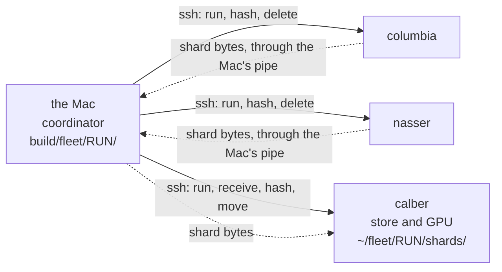
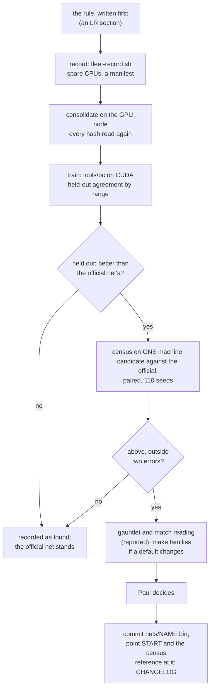

# Lab report: from spare cores to the official net

*Pipes, ssh and time in the recording fleet, and the road a set of matrix
numbers takes to become the learned tank's official net. 28 October 2026,
treadcore at `65f5683` (the run) and after; LAB-REPORT-BRAIN.md sections
106 to 108; `scripts/fleet-record.sh`, `tools/bc/`.*

Copyright (c) 2026 Paul Richeson. MIT licensed, as treadcore.

## Abstract

The learned tank is a file of 16,431 numbers: three matrices and three
bias vectors that turn 143 senses into 47 scores. Changing which file is
official is the end of a pipeline that crosses five machines. The CPUs
of four play the scripted brain in 1,200 matches and record what it saw
and did. The records are piped, over ssh, to the one machine with a GPU.
That machine trains new numbers on them. The census then judges the new
file against the official one on a single machine, and Paul decides.

This report explains each command in that pipeline. It covers who holds
whose keys, and why the bytes take the routes they take. It sets out
how the machines' time was spent, measured from the run's own logs: 200
hours of play recorded in 14 minutes, with a third of the two fast
machines' time spent moving and checking shards rather than recording.
It covers how each stage reports what it found, and which files say it.

Three faults were found and fixed on the way:

- a host whose login shell is not bash;
- a script edited while bash was still reading it;
- a GPU upload that pads every row of senses to 256 floats.

## I. The partners

| Machine | Address | Hardware | OS, login shell | Part |
| --- | --- | --- | --- | --- |
| the Mac | 192.168.8.143 | M1, 8 cores | macOS, zsh (bash 3.2 for scripts) | **coordinator**: holds the run's state, the only machine with keys to all the others; records at `nice 19` on 5 threads |
| calber | 192.168.8.181 | i7-9700F, 8 threads; GTX 1080 Ti | Ubuntu 24.04, bash | **store** (the shards are gathered here) and **trainer**; records on 8 threads |
| columbia | 192.168.8.224 | i3-N300, 8 threads | Alpine 3.24 (Copal), bash | records on 8 threads; the machine the census of a candidate is read on |
| nasser | 192.168.8.121 | i3-2310M, 4 threads, 7 GB | Alpine 3.24 (Copal), **busybox sh** | joined during the run; records at `nice 19` |
| saskatchewan | 192.168.8.235 | i7-13700F, 24 threads | Alpine 3.24 (Copal), bash | **not used**: its 24 threads were running `make converge` (load 23.8); spare means spare |

## II. Connectivity: a star, not a mesh



Only the Mac holds keys to the others. No machine can log into another,
so a shard recorded on columbia cannot be copied to calber directly.
There is no ssh inside ssh either: the connections are **not nested**.
The Mac opens two separate ssh sessions, one to the source and one to
the store, and joins them with a pipe in its own shell:

```sh
ssh columbia "cat ~/fleet/RUN/out/J.bin" | ssh calber "cat > ~/fleet/RUN/shards/J.bin.part"
```

The bytes cross the network twice, columbia to the Mac and the Mac to
calber, and are never written to the Mac's disk. That is the price of
granting no machine-to-machine trust. The alternatives, and why they were
not taken:

| Alternative | What it would do | Why not now |
| --- | --- | --- |
| `ssh -J mac calber` from columbia (ProxyJump) | columbia reaches calber through the Mac | columbia would need a key calber accepts: the trust the star avoids |
| agent forwarding (`ssh -A`) | columbia borrows the Mac's keys for the hop | anyone with root on columbia could use the Mac's keys while the session lasts |
| a key from each host to the store only | direct copies, bytes cross once | the cleanest of the three; a decision for Paul, since it changes who can log into the GPU node |

At gigabit speeds the relay cost columbia 12 s a shard of 585 MB (Section
V). That is cheap enough that the trust question can wait.

Every ssh call carries the same options. `BatchMode=yes`: never ask for a
password; a host without the key fails at once instead of hanging the
lane. `ConnectTimeout=10`. `ServerAliveInterval=30`: a dead link is
noticed during a long recording.

## III. The pipe commands, one by one

A **lane** is one loop per host, run on the Mac in the background. Each
pass is one job: 24 seeds, about a million samples, 585 MB.

### 1. Claim: `mv`

```sh
mv "$D/queue/9000084" "$D/claimed/columbia/"
```

`mv` within one file system is a rename, and a rename is atomic. When
four lanes reach for the same job, exactly one `mv` succeeds; the others
get "No such file" and try the next. There is no lock file and no server.

### 2. Run a command under bash, whatever the host's shell

```sh
ssh HOST "exec bash -c \"\$(echo <BASE64> | base64 -d)\""
```

where `<BASE64>` is the command text, encoded on the Mac. ssh hands its
command to the remote *login shell*, which is bash on calber and
columbia but busybox `sh` on nasser. The project's scripts need bash:
`scripts/common.sh` finds the repository from `BASH_SOURCE`, which only
bash sets. On nasser the first `prepare` failed with
`mkdir: cannot create directory '//build'`.

Sending the command as base64 means no quote or `$` is interpreted by the
login shell. `base64 -d` restores the text exactly and `bash -c` runs it.
The same command now runs identically on all four hosts (tested with
quotes, `$( )`, `\$HOME` and two lines).

### 3. Record

```sh
set -o pipefail
cd ~/fleet/RUN/wt && RECORD=$HOME/fleet/RUN/out/J.bin SEED0=9000084 SEEDS=24 SECS=600 THREADS=8 \
  nice -n 10 ~/fleet/RUN/census-bin --ignored learn::harness::train --nocapture 2>&1 | tail -4 \
  && [ $(wc -c < ~/fleet/RUN/out/J.bin) -gt 16 ]
```

| Part | Why |
| --- | --- |
| `~/fleet/RUN/wt` | a git **worktree** at the run's commit, so the host's own checkout is untouched (`prepare` makes it) |
| `census-bin` | the brain's test binary, built once by `census_bin` and copied: the code as it was when the run began, frozen like a census's |
| `RECORD= SEED0= SEEDS= SECS= THREADS=` | the harness's recorder (LR 106 A): 24 matches of 600 s on all 8 threads |
| `nice -n 10` | below anything interactive; 19 on the Mac and nasser, which people use |
| `2>&1 \| tail -4` | the lane log keeps the last four lines, not a million |
| `set -o pipefail` | without it the pipe's status is `tail`'s, always 0, and a crashed recording would look like success |
| `[ $(wc -c < ...) -gt 16 ]` | a second guard: a file of only the 16-byte header is a failure too |

### 4. Hash and size at the source

```sh
sha256sum ~/fleet/RUN/out/J.bin | cut -c1-64; wc -c < ~/fleet/RUN/out/J.bin
```

One ssh call, two lines back: the 64-character hash, then the byte count.

### 5. Move to the store: three routes

```sh
# the host is the store (calber): a rename
mv ~/fleet/RUN/out/J.bin ~/fleet/RUN/shards/J.bin.part
# the host is the coordinator (the Mac): one hop
cat ~/fleet/RUN/out/J.bin | ssh calber "cat > ~/fleet/RUN/shards/J.bin.part"
# any other host: two sessions joined by the Mac's pipe (Section II)
ssh columbia "cat ~/fleet/RUN/out/J.bin" | ssh calber "cat > ~/fleet/RUN/shards/J.bin.part"
```

Every route writes `J.bin.part`, never `J.bin`, so a half-written shard
can never be taken for a whole one.

### 6. Check at the store, then commit

```sh
ssh calber "sha256sum ~/fleet/RUN/shards/J.bin.part | cut -c1-64"   # must equal step 4's
ssh calber "mv ~/fleet/RUN/shards/J.bin.part ~/fleet/RUN/shards/J.bin"
ssh columbia "rm -f ~/fleet/RUN/out/J.bin"
```

The source's copy is deleted only after the two hashes agree. If they
differ, the job goes to `failed/` and the source keeps its copy.

### 7. Report the shard: one line of the manifest

```sh
printf '%s\t%s\t...\n' JOB HOST SEED0 SEEDS SAMPLES BYTES SHA256 BINARY_SHA256 SECONDS >> manifest.tsv
mv claimed/HOST/J done/HOST/
```

`samples` is computed from the size: (bytes − 16) / 586, the length of a
TCBC2 sample (143 senses × 4 bytes, 7 labels, 3 masks, a 4-byte seed). `binary_sha256` names the frozen binary that played the
matches (Section IV explains why that matters).

### 8. Consolidate: the store's own reading against the manifest

```sh
ssh calber "cat > ~/fleet/RUN/manifest.tsv" < manifest.tsv
ssh calber "cd ~/fleet/RUN/shards && sha256sum *.bin" | awk '{f=$2; sub(/\.bin$/,"",f); print f "\t" $1}' | sort > store.sha
cut -f1,7 manifest.tsv | sort > manifest.sha
cmp -s store.sha manifest.sha
```

Every shard is hashed again on the store and compared with what the lanes
reported. For `rec1200`: **50 shards, 1,200 seeds, 49,807,225 samples,
29.2 GB, every hash equal.**

### 9. Heartbeat and status

Each lane rewrites `lanes/HOST.beat` with a time and a state
(`recording`, `sending`) at every step. `status` turns these into "what
is each machine doing, and since when". A lane silent for longer than a
job takes has stalled.

## IV. One seed, three recordings

The same seed (9,100,000, 2 matches of 20 s) was recorded on calber,
columbia and the Mac. The results:

- **Three different shards**, one from each machine.
- Each machine reproduced its own shard exactly.
- The census has the same property: the simulation is deterministic per
  binary. These are three binaries: macOS on ARM, Alpine with musl, and
  Ubuntu with glibc.
- Even at one commit, a binary's bytes depend on the path it was built
  in. The run's binaries differ from the rehearsal's at the same commit,
  because the worktree path is written into the binary.
- nasser and columbia built byte-identical binaries (same Alpine, same
  Rust 1.96.1, same path), so their shards of a seed would match. That
  makes nasser an identity-check partner for columbia.

**What it means for the pipeline:** a recording is training data, not a
measurement. A seed recorded twice on different machines would be two
different examples, which is harmless to training. But a shard cannot be
re-made exactly except on its own binary, so the manifest names the
binary.

A census **is** a measurement, and the census rule stands: one machine
per census, never pooled across machines (CENSUS.md 5).

## V. How the time was spent

Read from the lane logs and the manifest of `rec1200`:

| Host | Jobs | Seeds | A job: recording + moving | Moving's share | Seeds a second |
| --- | --- | --- | --- | --- | --- |
| calber | 24 | 576 | 24 s + 11 s | 32% | 1.01 |
| the Mac | 21 | 504 | 26 s + 13 s | 34% | 0.94 |
| columbia | 5 | 120 | 152 s + 12 s | 8% | 0.16 |
| nasser | 0 | 0 | joined at 19:52, building its binary for 3.4 min; the queue was empty by then | | |
| **the run** | **50** | **1,200** | **19:35:52 to 19:49:51: 14 min** | | |

Notes on the table:

- **1,200 matches of 600 s is 200 hours of play, recorded in 14 minutes.**
  Claiming keeps the machines evenly loaded without any planning: the
  slow host simply takes fewer jobs. The three lanes finished within 32 s
  of each other.
- **Moving and checking took a third of the fast machines' time,** and
  the lane records nothing meanwhile. On calber, where the shard never
  leaves the machine, most of those 11 s is reading 585 MB twice for the
  two hashes. On the Mac it is the copy as well.
- **columbia is six times slower a seed** than calber (i3-N300 against
  i7-9700F). Its 12 s of moving is small beside its 152 s of recording.

What would use the time better, in order of gain:

1. **Record the next job while this one moves.** Two stages per lane
   instead of one. That is up to a third more recording on the fast
   machines.
2. **Hash while streaming:** `tee >(sha256sum)` at the source and the store
   reads the shard once rather than twice.
3. **Jobs sized by host speed,** so a slow machine's last job does not set
   the run's end. Here it did not, because columbia's last job ended
   before calber's.
4. **Direct host-to-store copies** (Section II), if the trust is granted.

The GPU's time is a separate matter (LR 107, 108). Training is a queue of
one on calber; how the card's time is used is set by the batch size and
by whether the training set stays on the card or is streamed through it.

**A GPU fault found while streaming:** a [N, 143] tensor uploaded to the
card is stored with each row padded to 256 floats, 1,024 bytes a sample.
The evidence is two refused allocations of exactly 1,024 bytes × N. The
senses are now uploaded flat and reshaped on the card. No single upload
is allowed above 2 million samples, since CubeCL refused a 3.7 GB buffer
on a card that was nearly empty.

## VI. How findings come back

Each stage writes its findings to files. These files are the record;
nothing is held only in a terminal.

| Stage | Where it reports | What it says |
| --- | --- | --- |
| a lane | `build/fleet/RUN/lanes/HOST.log`, `.beat` | each job's seeds, success or failure, bytes, seconds; what it is doing now |
| the run | `manifest.tsv` (on the Mac and beside the shards) | every shard: job, host, seeds, samples, bytes, hash, binary, seconds |
| consolidation | the `cmp` of store and manifest hashes | whether every byte arrived |
| training | the trainer's log | read time; each epoch's loss and wall time; held-out agreement **for each held-out seed range**, against always the commonest label |
| the card | `tools/bc/sweep.sh` → `sweep.tsv`, `dmon-*.log` | epoch time, samples a second, the card's busy share and memory, a row per batch size |
| the census | `build/census/STAMP/` on the census machine; `ledger.py` | the paired difference against the official net, its standard error, by map |
| the people | LAB-REPORT-BRAIN (an LR a step), a check-in (CI), the journal, CHANGELOG, ROADMAP | the rule written before, the numbers, what they mean |

Next (LEARNING-DESIGN IX): each lane publishes its events on the
fleet's message bus as well as writing them, so a wall can show every job
live and an alert can say when one stops. The files stay the record.

## VII. The official net: what is stored, and how it changes

### What is stored

A net is a `TCNET1` file (`Net::save`, `net.rs`). For the learned tank's
shape, 143 → 64 → 64 → 47:

| Bytes | Field |
| --- | --- |
| 8 | the magic `TCNET1\0\0` |
| 4 | the number of layer sizes, 4 (u32, little-endian) |
| 16 | the sizes 143, 64, 64, 47 |
| 36,608 + 256 | layer 1: a 64 × 143 weight matrix, **row by row (output-major, w[o × 143 + i])**, then 64 biases; f32, little-endian |
| 16,384 + 256 | layer 2: 64 × 64, then 64 biases |
| 12,032 + 188 | layer 3: 47 × 64, then 47 biases |
| **65,752** | in all: 28 bytes of header and **16,431 numbers** |

The 47 scores are the seven heads, in order:

| Head | Choices |
| --- | --- |
| drive | 10 |
| gun | 9 |
| lead | 3 |
| mortar | 9 |
| drone | 5 |
| squad | 7 |
| signal | 4 |

`NetBrain` runs a file with Rust's own `Net::forward` and picks each
head's best *allowed* choice (`choose`, with the masks). Whatever trained
the numbers, a CPU or a GPU, ES or behaviour cloning, **only Rust plays
them**, so the census reads every net the same way. Parity check 1 (LR
106 D) proved that a net trained on the GPU plays in Rust exactly as it
did in training.

The scripted brain's own scalars are a different listing:
`source/treadcore-brain/src/weights.rs`, a named weight per line (`w_near
1.0`, `w_wounded 1.2`, ...), tuned by `make converge` on saskatchewan.
This report is about the net.

### Which net is official

`nets/map7.bin`. It is where `make school` starts (`START`'s default),
the net the gauntlet compares, and the trial team every learned net is
read against in the census: −20.33 ± 0.27 against the scripted brain, on
saskatchewan and columbia alike. bc1 did not replace it: −2.85 ± 0.44
below it, paired (LR 106 F).

### The road to replacing it



Every arrow is a file another machine can check. The numbers in a
candidate are written once, by the trainer. The census never reads them
on a second machine for the same result. Nothing becomes official
without the rule written before the run, a paired census outside two
errors, and Paul's word. Committing `nets/NAME.bin` is the change to the
official listing; the commit names the LR section that justified it.

### Where `rec1200` stands on that road

Done:

- the rule (LR 108 B);
- the recording (50 shards, every hash checked);
- the trainer rewritten for 20 times the data:
  - compact samples, streamed through the card in uploads of at most 2
    million samples;
  - the flat upload of the senses;
  - its learning checked against the old trainer's.

Next:

- the batch sweep;
- `bc2` on the 1,134 recorded seeds outside the held-out ones (1,260 recorded:
  the first 60 and these 1,200; held out, bc1's 6 and the last 120);
- `bc2`'s agreement on bc1's held-out seeds;
- `bc2` against `bc1` in the census on columbia.

This report's Section VIII gets the result when there is one.

## VIII. Results: how far bc2 got along the road

| Stage | Result | Where |
| --- | --- | --- |
| the card's batch | 32,768 fills it (3.15 million samples a second); both halving and doubling are slower | LR 108 C |
| training | 47 million samples, 12 epochs in 226 s, streamed at 2.6 million a second | calber `~/bc/bc2.log` |
| held out | drive 66.6% against bc1's 65.5%: past the rule's bar | LR 108 C |
| census against bc1, one binary | **+3.42 +/- 0.41**: past the bar | columbia `build/census/20261027-200745`, `-201716` |
| census against the official net | **+0.57 +/- 0.37**: inside the noise, so **not** past the bar | paired with `20261027-183427` (the two binaries play every seed identically) |
| gauntlet, match reading | survives (0.03 deaths), goes nowhere (0% on every journey) | LR 108 D |

**The road stops at the census against `map7`.** bc2 is level with the
official net, not above it, so nothing is committed as official and Paul
is not asked to decide. `nets/bc2.bin` stays a candidate on calber and
columbia, with its numbers in LR 108.

## IX. The process as a loop: fleet-train, and watching it

Everything above was done by hand, one step at a time. orrery's
`tools/fleet-train.sh` runs the same steps as rounds, until told to stop
(LAB-REPORT-BRAIN section 109). On the Mac:

```sh
cd ~/code/treadcore
~/code/orrery/tools/fleet-train.sh run    scripts/fleet-train-stages.sh   # until stopped
~/code/orrery/tools/fleet-train.sh stop   scripts/fleet-train-stages.sh   # after the round in hand
```

A round, and where its time goes:

| Stage | Machines | What it runs | About |
| --- | --- | --- | --- |
| record | calber, columbia, the Mac, nasser (the hosts file) | `fleet-record.sh plan / prepare / run / consolidate`: 1,200 matches in jobs of 12 | 3 min to build, then about 20 to 30 min |
| train | calber's GTX 1080 Ti | `treadcore-bc` with `START=` the loop's best: 4 epochs over the round's 50 million samples at batch 32,768 | 2 to 3 min |
| judge | columbia | `make census` of the candidate (and of the best again if the binary differs), paired by seed | 10 to 20 min |

The first rounds take matches already recorded (`PREMADE`: `rec2400` in two
halves) and skip recording.

**Who decides what.** The judge keeps the loop's best: a candidate replaces
it only when the census, paired by seed on one binary, puts it above the
best outside two standard errors. The official net is a separate matter
(Section VII): when the loop's best is also above `nets/map7.bin` outside
two errors, the round says so, and Paul decides.

**Watching it.** Two places show the same files:

- **The terminal.** `fleet-record.sh watch RUN` shows a run's queue live. It
  draws a bar of jobs done, then a line per machine (its jobs, seeds a
  second, what it is doing and since when), and stops when the run ends.
  `fleet-train.sh status` lists the rounds and their verdicts.
- **orrery's museum interface, the Jobs view.** `orrery --gui --jobs-cmd
  "fleet-train.sh status STAGES --json"` shows the fleet as one computer:
  - each round's stages as lit chips;
  - the round in hand's queue as one bar;
  - every machine's lane: its job, state and age, and **the pipe it is
    running**, spelled as in Section III.

  It has no verbs: the loop is started and stopped from a shell.

A picture of the Jobs view during `rec2400` is in orrery's `docs/fleet-train.md`.

**Every step reports to a file** (Section VI). The loop adds
`events.jsonl` (a line an event: round, stage, started, done or failed,
with a detail) and a `summary.txt` per round. `status --json` turns these,
with each machine's lane (`scripts/fleet-jobs.py`), into the one document
the Jobs view reads.

## X. Lessons

1. **Spare means measured.** Every host's load was read before it was given
   work; the one busy machine got none.
2. **Never trust a pipe's exit status without `pipefail`,** and check the
   artefact as well: a file bigger than its header.
3. **Never trust a remote login shell to be bash.** Run the command under
   bash explicitly, and send it as base64 so no quoting is read twice.
4. **A non-interactive ssh does not read `~/.profile`,** so `~/.local/bin` is
   not on its path. copal-tm looked absent on columbia and saskatchewan,
   but was installed there by the Copal Store. It was absent only on
   nasser, where it was never chosen from the Store; it is installed
   there now, and all four machines run the same commit (`8459277`).
5. **Do not edit a script while bash is running it.** Bash reads a script as
   it goes. Both edits during the run were written into the same file
   (same inode), so when the running `case` ended, bash would have
   carried on from its old byte offset into the middle of the new text.
   The fix was to write the original text back into the same inode and
   run the new version from a copy; the change went in after the run
   ended.
6. **Hash at both ends, rename only after,** and write `.part` until
   then.
7. **A shared build directory shares binaries.** The fleet's worktrees
   built into columbia's own `target/`, and the next census there used
   that build, not one of its own. It played the same matches (bc1's
   census was identical, seed for seed, on both binaries), but a census
   must run the binary it names. The fleet now builds into
   `~/fleet/target`.
8. **On the card, read the allocation that fails:** its size divided by the
   rows gave the padding (1,024 bytes a row), which no documentation
   stated.
