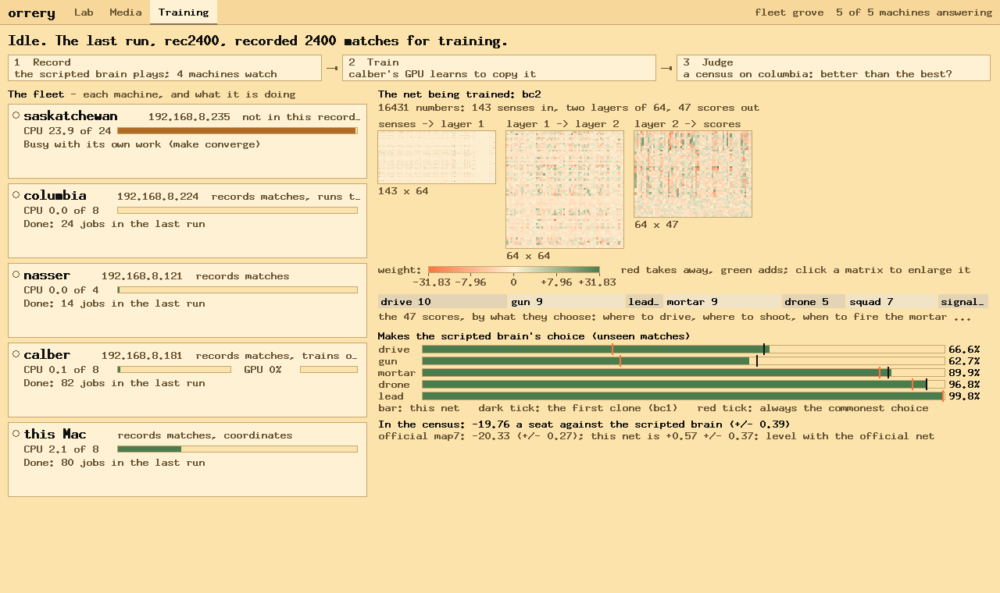
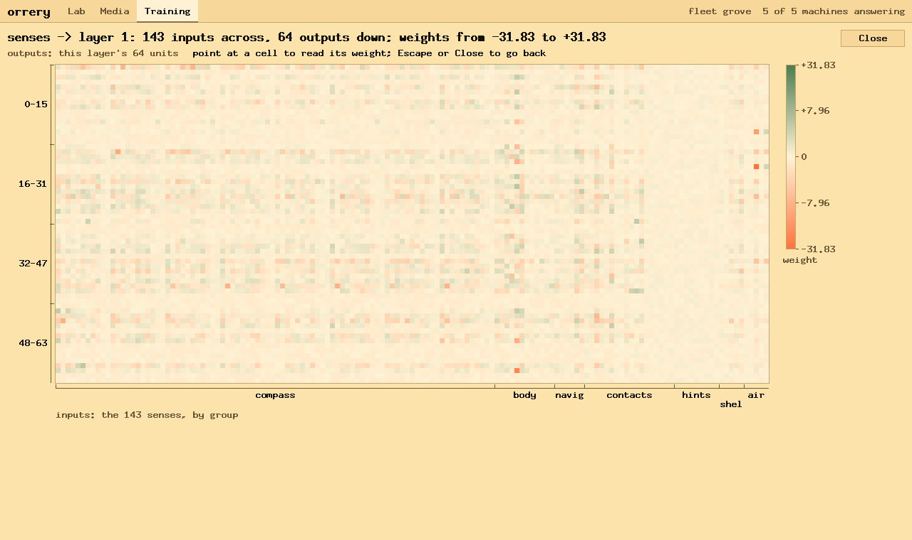
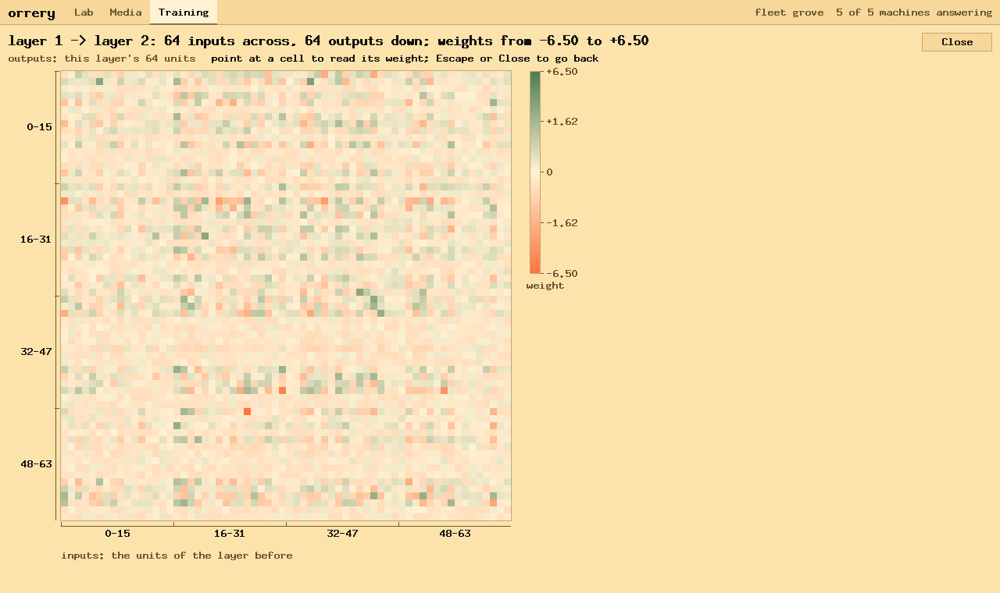
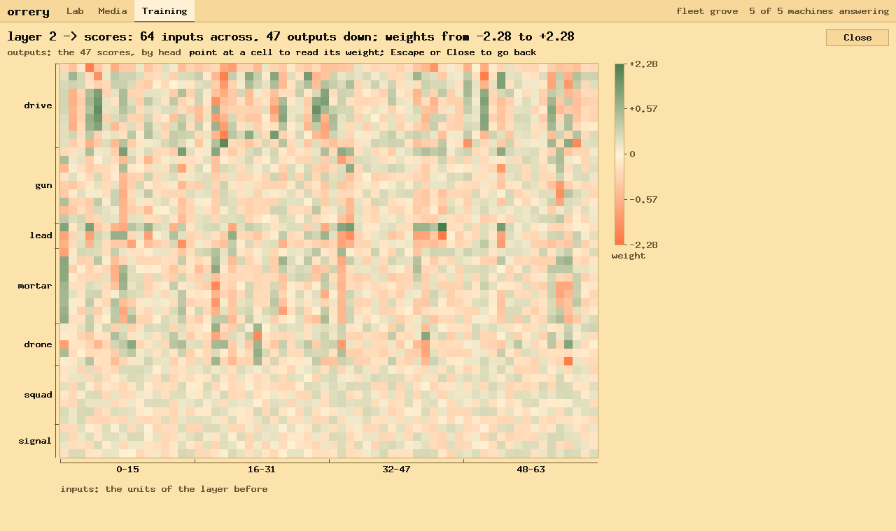
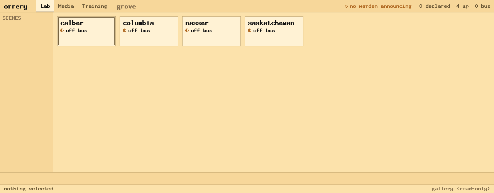

# Lab report: the net in orrery

*Pictures of orrery's Training view, why the learned tank's weight
matrices look the way they do, and what the view needs to show how
training goes. 28 October 2026. The same report as a page, with markers
on the pictures: `reports/2026-10-28-the-net-in-orrery.html`.
Companions: LAB-REPORT-BRAIN.md sections 106 to 109; LAB-REPORT-FLEET.md;
orrery's `docs/fleet-train.md`.*

## Abstract

orrery's Training view draws the net being trained: `bc2`, the clone of
the scripted brain trained on 47 million moments of its play. It is a
fully connected net, 143 senses in, two layers of 64 units, 47 scores
out: 16,431 numbers. The pictures are explained here from measurements of
its file, `nets/bc2.bin`, and of 200,000 recorded moments.

What the measurements show:

- 24 of the 143 senses are never non-zero, and their weights are still
  random.
- 2 of the 7 decisions (squad, signal) were never trained.
- Two senses carry the largest weights: how close a drone is (31.8), and
  the tank's speed (23.1).
- The first matrix's colour scale is set by its largest weight, while its
  median weight is 0.07. That is why the first matrix looks washed out.

The view needs, first of all: a colour scale that a few weights cannot
wash out, progress over rounds, and what each round changed.

| | |
| --- | --- |
| numbers in the net | 16,431 |
| senses never non-zero in the sample | 24 of 143 |
| largest weight / median | 31.8 / 0.07 |
| negative weights, first two layers | 59%, 60% |

## I. The Training view

Drawn by orrery at 1280 × 760 from the document `scripts/fleet-view.py`
printed, after the run rec2400 had ended. From the top:

1. **What is happening,** in a sentence.
2. **The round's three steps:** record, train on calber's GPU, judge in
   the census on columbia. The current one lights up.
3. **The fleet (left), a card a machine:**
   - its role;
   - CPU load against cores (and calber's GPU);
   - what it is doing now in words, with the command doing it.
4. **The three weight matrices (right),** small: inputs across, outputs
   down. Click one to enlarge it.
5. **The legend:** red takes away from a unit, green adds.
6. **The 47 scores by decision:**

   | Decision | Choices |
   | --- | --- |
   | drive | 10 |
   | gun | 9 |
   | lead | 3 |
   | mortar | 9 |
   | drone | 5 |
   | squad | 7 (untrained) |
   | signal | 4 (untrained) |

7. **Agreement with the scripted brain** on unseen matches, a bar per
   decision. The dark tick is bc1. The red tick is always choosing the
   commonest choice: a bar is only good well past its red tick.
8. **The census** against the official net map7: level.

## II. Why the first matrix looks pale and striped

The 143 senses run across, the first layer's 64 units down. Each cell is
one weight: green pushes that unit up, red down.

**A. Almost everything is pale because one weight sets the scale.**
- The scale runs to ±31.83, the matrix's largest weight.
- The median weight is 0.071, and 99% of weights are under 2.32.
- So a typical weight is drawn at about a twentieth of full strength.

**B. The compass repeats every 11 columns** (left two thirds).
- The first 88 senses are 8 sectors × 11 channels, so a channel's pattern
  shows 8 times across.
- Channel 0, a hostile tank that way, carries the most weight of any
  channel (mean |w| 0.43). The net attends most to where the enemy is.

**C. The hints are a pale band (columns 124 to 132) because they were
never on.**
- All 9 were zero in every recorded moment. A weight on a sense that is
  always zero gets no training signal, so it keeps its random starting
  value (between ±1/√143 = ±0.084).
- Measured: mean |w| 0.041, what an untouched start gives.
- The same holds for:
  - the friend's-call channel, the last column of each group of 11;
  - the six contact senses describing a call.
- Scripted matches make no calls.

**D. Column 92, the tank's speed, has the second-largest weight (23.1).**
Drive's commonest answer is stop, and speed tells stopped from moving.

**E. Horizontal stripes are units that listen to many senses at once.**
Pale rows are units that barely listen.

**F. Column 140, how close a drone is, has the largest weight in the net
(31.8).** It matches the gauntlet's G4: the clones dodge a strike drone
96 to 99% of the time, more often than the scripted brain (95.5%).

The orange cast is real: 59% of this matrix's weights are negative. That
is common with ReLU units, which many weights keep quiet until the right
senses are present.

## III. Why the middle matrix looks like noise

The hidden units have no natural order. Shuffle the 64 units, and the
matching rows and columns, and the net computes exactly the same thing.
So a hidden-to-hidden matrix has no meaningful shape: only rows or
columns that stand out mean anything.

It did learn: mean |w| 0.186, three times the 0.0625 of an untrained
layer of this size, and its largest weight is 6.50.

## IV. Why the last matrix has quiet bands at the bottom

**G. Drive and lead are the strongest rows** (mean |w| 0.24, 0.26).

**H. Squad and signal (the bottom 11 rows) are faint, even noise:
untrained.** No label is recorded for them, so they keep their starting
weights: largest 0.12, under the starting bound of ±0.125. What the net
does with those two decisions today is random.

**I. Vertical stripes are units many decisions use.** Units 18, 7, 0, 60
and 33 have the strongest outgoing weights.

## V. The interface today

Three views, chosen in the header or with Command-1 to 3. None of them
changes anything yet.

- **Lab: the real fleet, grove.** calber, columbia, nasser and
  saskatchewan, from `copal fleet state`. They say "off bus" because they
  have not been enrolled: no fleet agent runs on them.
- **Media:** the SD cards and images the machines were installed from.
- **Training:**
  - Refreshes every 5 s from one document (about 140 KB), which
    `scripts/fleet-view.py` prints in about 1.5 s: each machine over ssh,
    the newest recording run, the loop's state, the best net and its
    results.
  - Text is drawn a pixel bolder for legibility.
  - Clicking a matrix enlarges it, with labelled axes, a legend and the
    weight under the pointer.

## VI. What it needs to show how training goes

The view is a snapshot of one net. Analysing training is seeing change.
In order of value:

1. **A colour scale a few weights cannot wash out:** 99th-percentile
   scaling, clipped cells marked, a histogram of weight sizes.
2. **Progress over rounds:** loss per epoch, agreement per decision and
   the census with error bars, as lines, with the official net as a
   reference.
3. **What each round changed:** candidate minus best, per matrix.
4. **Which senses each decision listens to:** a 7 × 7 map of decisions by
   sense group.
5. **Where each decision goes wrong:** a confusion table per decision
   (the drive head's stop habit would be one bright column).
6. **Which inputs are alive:** a strip under the first matrix of how often
   each sense is non-zero, with dead senses and untrained decisions
   marked.
7. **Healthy units:** units never active or always active on held-out
   moments.
8. **The 110 scripted-brain weights as the trainer tunes them:** a curve
   per weight, the trials queued, the candidates waiting.
9. **The queue and its controls:** jobs by kind, machines' use over time,
   "stop adding" and "collect results and stop now" in operator posture.
10. **Names on hover:** "sector 3, hostile tank", not just "compass".
11. **Two nets side by side,** and a choice of round.
12. **Fast and slow refreshes apart:** machines every few seconds, the
    net when a round ends.

## VII. Method

The figures here come from three places:

- **The weights:** read from `nets/bc2.bin` (`Net::save`'s TCNET1 form:
  each layer's weights output-major, then its biases).
- **The senses:** mean, spread and share non-zero, from 200,000 samples
  of shard 9000060 of the run rec1200. The layout is from `senses.rs`
  (SECTORS × CHANNELS, BODY, NAV, CONTACTS, HINTS, SHELL, AIR).
- **The starting bounds:** Burn's default for a linear layer, ±1/√inputs.

The pictures were drawn by orrery's `--frame` at ccb3ae2, with
`ORRERY_FRAME_ZOOM=N` for the enlargements.
