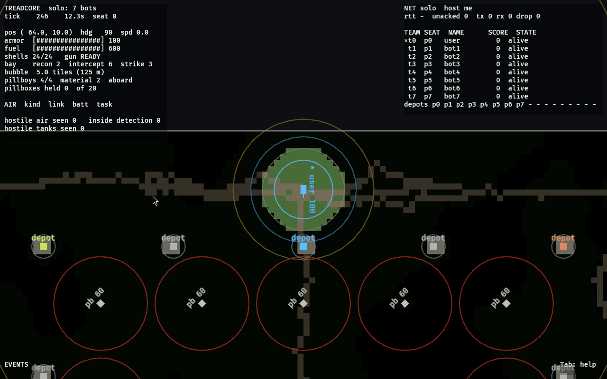
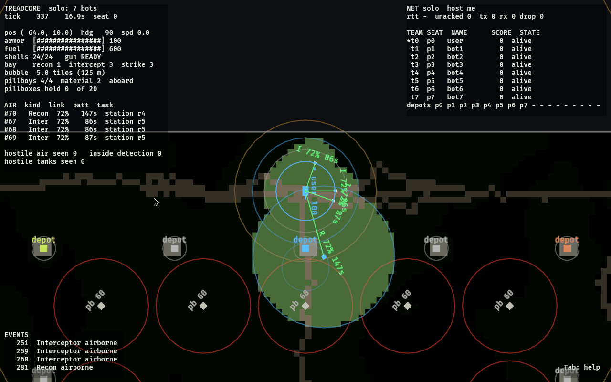
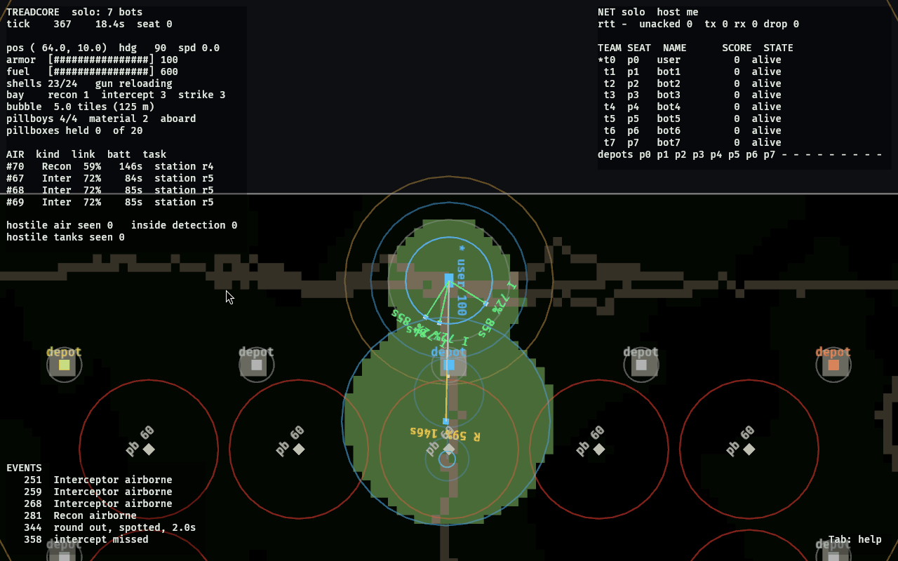
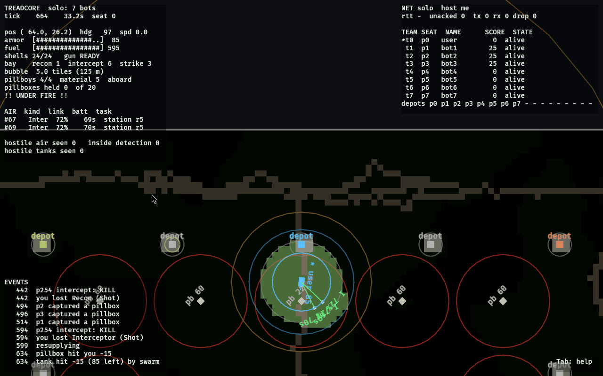
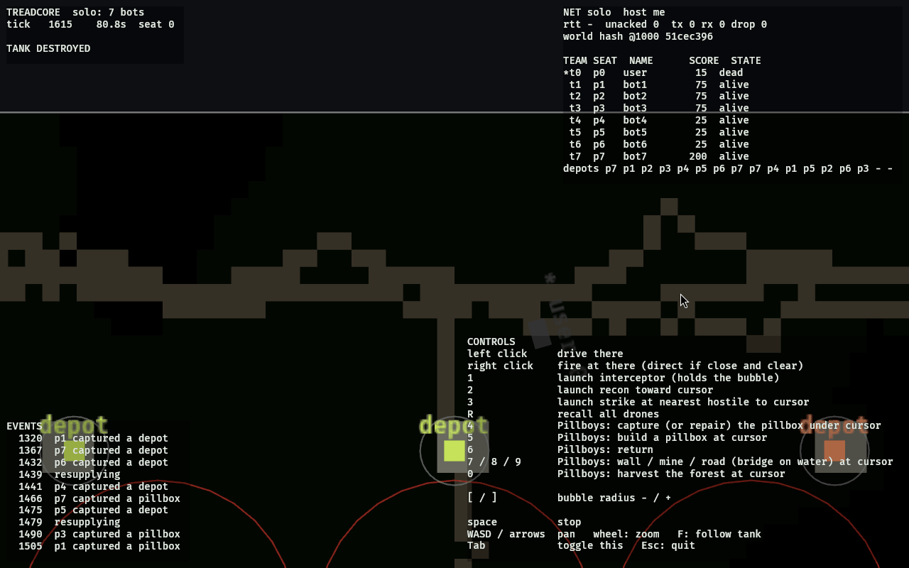
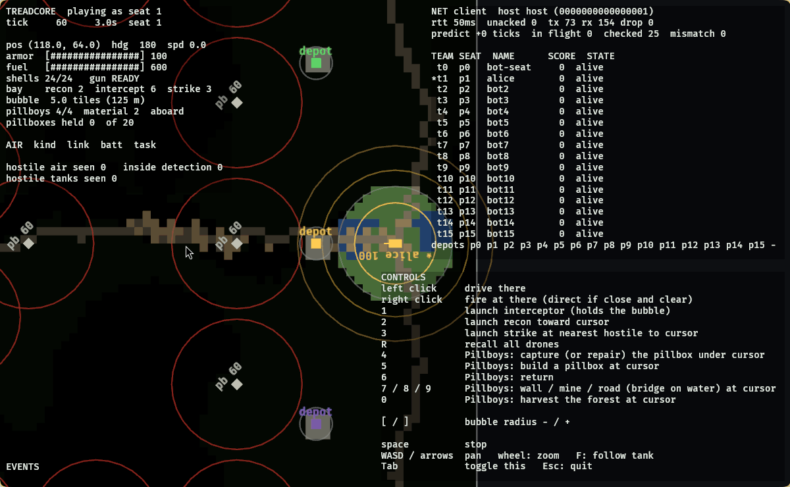
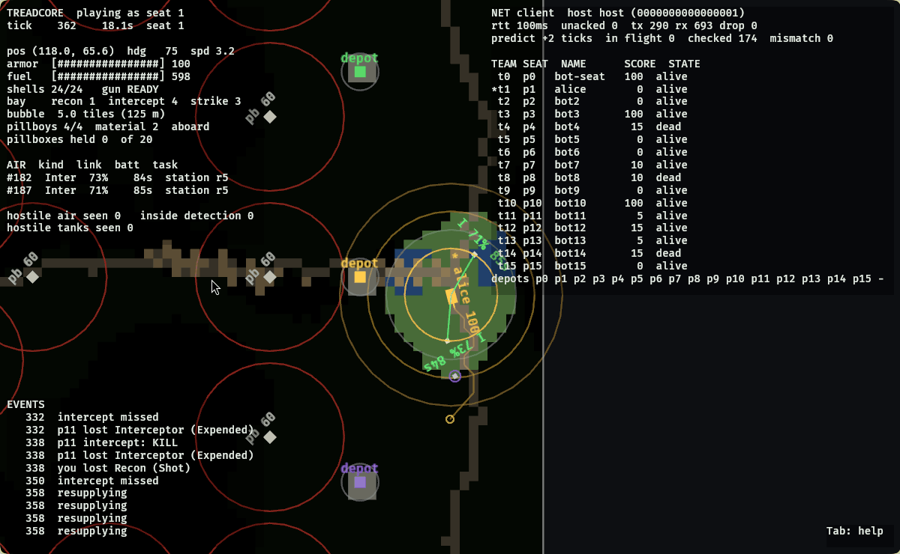
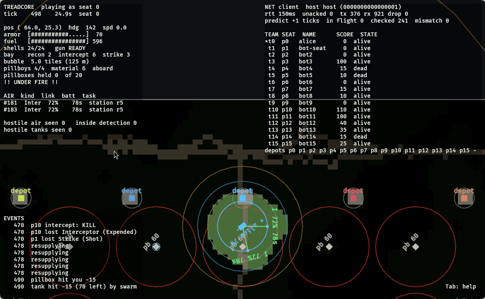
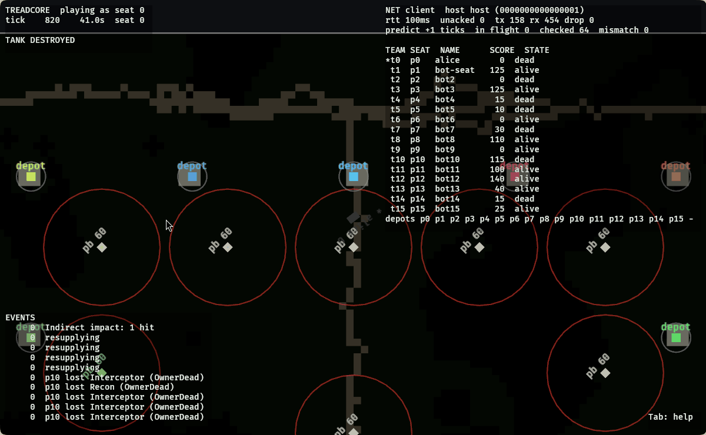

# treadcore: lab report, the first playtest build

13 October 2026. The first time the window opened in the VM it is
developed in, the first match played in it, and the first time several
clients met through the introducer with a human seat among them. With
pictures. The code walk-through is `LAB-REPORT.md`; the day's journal
is `journal/0013`. Pictures are in `reports/images/`, and the website's
gallery shows them.

## 1. What was built

The window had never been seen here. Journal 0002 recorded why: the VM
has no GPU, Alpine installs no Vulkan driver, and wgpu will not start
without one. Two things changed today.

**The driver.** `mesa-vulkan-swrast`, lavapipe: Mesa's Vulkan on the
CPU. It was added to copal's full monty (the desktop install for this
VM) so the next machine gets it unasked; this one got it by hand.

**The stack.** With the driver in, every binary built on Bevy, the
game and the engine-only `treadcore-warm` alike, segfaulted before its
first frame. gdb put the crash in `llvm::AsmPrinter::doFinalization`,
on a thread lavapipe had created to compile a shader. musl, Alpine's
libc, gives a thread 128 KiB of stack unless told otherwise; LLVM's
code generator is deeper than that, and lavapipe does not say
otherwise. glibc gives 8 MiB and never sees the problem, which is why
nobody upstream has. `LP_NUM_THREADS` does not touch the compile
thread. The fix is `scripts/bigstack.c`: twelve lines whose
constructor calls `pthread_setattr_default_np` with 8 MiB, built by
`make configure` into `build/bigstack.so` on any musl machine and
preloaded by `make run` and `make lan`. No root, no Mesa rebuild. With
it the spinner spun and the game ran.

| part | version |
| --- | --- |
| guest | Alpine, aarch64, UTM on a Mac, 4 cores, 8 GB |
| compositor | Hyprland on Wayland; the game ran under Xwayland for the shoot |
| Mesa, LLVM | 26.1.6, 22.1.3 (lavapipe, "128 bits") |
| musl | 1.2.6 |
| Rust, Bevy | 1.98.1, 0.17.3 |
| treadcore | b6060c5 plus this report's changes; wire version 11 |

The release window links in 21 s once the engine is warm.

## 2. The first run: solo

`treadcore --solo --players 8`: one human seat, seven RuleBots, the
default seed. Driven by `xdotool` from a script so every frame is
reproducible; the window was fullscreen for the solo frames and a
1200 x 740 floating window for the networked ones.



*The start.* Seat 0 at the north start, tick 227. Left: the tank's
telemetry (position, heading, armor, fuel, shells, the bay by kind,
the bubble, the squad) and the AIR table, empty. Right: the NET line
and the roster, eight seats, a depot strip. The map: the ring road,
the spoke south, the home depot in team colour, the neutral pillboxes
with their 8-tile rings in red, the eight nearest forest tiles in
green, the fog beyond the tank's 5-tile vision. The controls overlay
was still up here; Tab hides it.



*Three interceptors on station, a recon out.* The bubble is the blue
ring at 5 tiles; the interceptors sit on it, each with a link line
from the tank, labelled I, link quality and battery seconds. The recon
went toward the cursor, 8 tiles south, and the disc it sees is the
lighter area over the spoke. The amber ring is detection: a strike
crossing it is the warning.



*A round out, spotted.* Right-click 30 tiles down the spoke. The
events say `round out, spotted, 2.0s`: the recon sees the impact point,
so the shell lands inside 0.6 tiles rather than 4. The arc is the
yellow line from the tank, the impact point the circle at its end,
growing as the shell falls. The gun shows `reloading`; 23 of 24.



*Under fire.* Tick 664, 33 s in. The tank has driven south to the home
depot (`resupplying`), the swarm from the map edge has hit it once for
15, a neutral pillbox has hit it once for 15, and `!! UNDER FIRE !!`
is on the telemetry. Two interceptors left; one died to a bot's shell
splash, which is what the design says a shell does to a ring. Material
5 after the squad harvested beside the start.



*Eighty seconds, tank destroyed.* The first solo run, zoomed out: the
human tank stood at its start and three bots' indirect fire found it
by tick 1 615. The roster shows the bots' scores from depots and
pillboxes captured; the event log is theirs. The world hash at tick
1 000 is on the NET line even solo.

The simulation held 20 ticks a second throughout on the CPU
rasteriser: tick 664 at 33.2 s, tick 1 615 at 80.8 s. The desktop's
CPU meter read 86 to 93 % with one window up.

## 3. The multiclient run

Three peers on this machine, the step 7 way: no LAN broadcast, an
introducer only.

| process | how it was run |
| --- | --- |
| introducer | `treadcore-server --introduce --port 47300` |
| host | `treadcore-server --net --want 3 --introducer 127.0.0.1:47300 --no-beacon --identity host.id --players 16 --defenders 4 --record replay.json`; the identity file holds `0000000000000001`, the smallest id, so it wins any tie |
| bot seat | `treadcore-server --net --want 3 --port 0 --introducer ... --no-beacon`, with `TREADCORE_LAG_MS=30` |
| the window | `treadcore --lan --name alice --want 3 --introducer ... --no-beacon --identity alice.id`, with `TREADCORE_LAG_MS=30` |

The lag on the two seats is what made the headless process the host:
the election picks the peer whose worst link is best, and the lagless
one measures 30 ms to each seat while the seats measure 60 ms to each
other.



*Playing as seat 1, tick 60.* Three seconds after the window opened.
The lobby had registered, been introduced to two peers, probed them,
shared rows, and agreed: `host host (0000000000000001)`. The NET line
shows rtt 50 ms, 73 packets out, 154 in, 0 dropped, and the prediction
line: `predict +0 ticks, in flight 0, checked 25, mismatch 0`. Sixteen
seats in the roster: alice, bot-seat, fourteen bots of which the last
four are Defenders. The east start this time.



*Driving, predicted.* A left-click 8 tiles south; the tank is the
predicted one, drawn where the client's own copy of the world has it,
two ticks ahead of the last snapshot (`predict +2 ticks`). 174 checks,
0 mismatches: every snapshot's tank was bit for bit what the client
had predicted for that tick. A bot's strike was shot down by alice's
interceptor at tick 338 (`p11 intercept: KILL` is p11's; `you lost
Recon (Shot)` is a pillbox's doing).



*Sixteen seats, twenty-five seconds in.* The third run. alice at the
north start, two interceptors up, under fire from the swarm; four bots
already dead to each other; rtt 150 ms as the host measures it
(60 ms of simulated link plus up to a snapshot interval), 241 checks,
0 mismatches.



*Back in seat 0.* The window was killed with SIGKILL at eight seconds,
no Leave sent, and started again with the same identity file. Its
lobby registered, was told `0000000000000001` is hosting, pinged it,
heard back, and joined with no election; the host logged `seat 0
'alice' is back ... its seat and sequences given back` and welcomed it
at tick 561. By this frame, tick 820, the tank the window came back to
had been destroyed by the bots: a human tank that stands at its start
for thirty seconds does not survive fifteen bots, which is the game as
it is, and a finding for the interface (section 5). The seat, the
score and the name are the ones that left.

| run | welcomed at tick | killed | back at tick | checks | mismatches |
| --- | --- | --- | --- | --- | --- |
| second | 8 (seat 1) | 61 s | 776 | 543 | 0 |
| third | 9 (seat 0) | 25 s | 561 | 241 | 0 |

## 4. The multiclient, explained

What happened between the window opening and "playing as seat 1",
with the files that do it.

```
 identity file         introducer                 host           bot seat
 (alice.id)            :47300                     (id 1)         (lagged)
     |                     |                         |               |
 1.  |--- Register ------->|<------ Register --------|<-- Register --|
     |     every second    |   hosting: false        |               |
 2.  |<-- Introduce -------|------- Introduce ------>|-- Introduce ->|
     |  (public, local)    |                         |               |
 3.  |--- Hello (punch) -------------------------->  |               |
     |<-- Hello -----------------------------------  |   (and the    |
     |--- Ping x15 / Pong, 100 ms apart ---------->  |    same with  |
 4.  |--- RttRow (my median rtt to each) ---------->  |    the seat)  |
     |<-- RttRow ---------------------------------  |               |
 5.  |   elect(matrix): everyone computes the same answer: host = 1   |
     |--- Elect {host 1} -------------------------->  |               |
 6.  |--- Join {peer, name, session} ------------->  |               |
     |<-- Welcome {player 1, scenario, tick 8, map} (in Chunks)      |
 7.  |<-- Snapshot every other tick (10 Hz), Events (reliable),      |
     |    Heartbeat {tick, hash, rtt_ticks} every 500 ms             |
     |--- Command {seq, Move} ---------------------> applied, acked   |
 8.  |    predict: the copy drives the tank now; reconcile on each   |
     |    snapshot; check bit for bit when nothing is in flight      |
```

1. **Identity.** `--identity alice.id` reads sixteen hex digits, or
   writes fresh ones the first time (`introducer::identity_from_file`).
   A peer id is what a seat belongs to; keeping it in a file is what
   lets a restarted process be the same player.
2. **Rendezvous.** With `--no-beacon` nothing is shouted on the LAN.
   The lobby registers with the introducer every second
   (`Registration::poll`), giving the LAN address it sees for itself;
   the introducer notes the address the datagram came from, which on
   the Internet is the one a home router rewrote. Every second, and at
   once when someone new appears, the introducer sends everyone in the
   lobby name an `Introduce` with everyone else's two addresses. A
   registration lapses after thirty seconds.
3. **The punch.** Every introduced peer is greeted at both addresses
   every 250 ms (`Lobby::punch`) until a packet comes back from it;
   the address it came from is the peer's from then on
   (`heard_from`). On loopback both addresses work and the first
   answer wins; across routers the first packet out is what opens
   each side's router for the other's packets in.
4. **The matrix.** Probe: ten pings a second to every peer for 1.5 s;
   the median round trip is this peer's row. Share: rows are exchanged
   until everyone's is in.
5. **The election.** `election::elect` is a pure function of the
   matrix: Dijkstra from every candidate, out if it cannot reach
   everyone even by relay, the winner the one whose worst path is
   shortest, ties by total then by id. Every peer computes the same
   answer from the same rows and announces it; the lowest id's
   announcement is final when rows were lost. Here: the lagless
   headless process, id 1.
6. **The session.** The window sends `Join` every 500 ms with a
   session number random to this process; the host answers with the
   `Welcome` (player 1, the scenario, the current tick, the map as it
   is now), in `Chunk`s because a map is bigger than a datagram.
7. **Playing.** The host steps the world at 20 Hz with every seat's
   orders sorted by player, sends each seat what it may see every
   other tick (unreliable, newest wins), the events it may know about
   (resent until acked), and a heartbeat with the world hash every
   half second. Orders carry a sequence number and are resent until
   acked; the host applies each once, in order.
8. **Prediction.** The window's own tank is run by the window: a
   partial copy of the world from the `Welcome`, hull orders applied
   when sent, one tick every 50 ms by the same `drive_tank` the host
   runs, every snapshot adopted and the ticks ahead re-driven. `predict
   +2 ticks, checked 174, mismatch 0` on the NET line is that.

And the way back: while hosting, the host keeps registering with
`hosting` set. The restarted window registers, is introduced to a
hosting peer, pings it instead of greeting it (a host runs no lobby,
but answers a `Ping` from any peer that has a seat), and decides for it
with no election the moment it answers. Its `Join` has a new session
number; the host sees the old peer id with a new session, gives the
seat back at the tick the match has reached, and starts the seat's
sequence numbers over so the first order from the new process is
applied. `PROTOCOL.md` has the packet-level account.

## 5. Findings

Numbered, as the journal carries them.

1. **The segfault was the libc's, not the driver's.** Section 1. The
   fix is in the build; `make configure` says `libc musl: built
   build/bigstack.so` on a machine that needs it and nothing on one
   that does not. A glibc machine with lavapipe would never have
   found it.
2. **The rtt on the HUD was heartbeat age.** The first networked frames
   read 200 to 450 ms on a link with 30 ms each way. Backlog item 5
   (journal 0009) had made the figure the host's measurement, the host
   tick echoed by the client subtracted from the host's current tick;
   but the client echoed the tick from the host's last *heartbeat*,
   half a second old. It now echoes the newest tick it has seen from
   any snapshot (`Client::poll`), and the frames read 50 to 150 ms:
   the 60 ms link plus up to one snapshot interval.
3. **The telemetry and NET panels overlap below about 700 px.** Both
   are anchored to the top; in a tiled half-screen window the NET
   panel's roster sat on the telemetry. The HUD assumes a wide window.
   Interface work (`INTERFACE.md`).
4. **The controls overlay is the first thing a player sees, and it
   covers the map.** It is help, and it is modal in effect. Same.
5. **After a rejoin the event log stamps events tick 0** until the
   first snapshot arrives, because `push_events` takes the tick from
   the view's last observation. Cosmetic; one line in the window's
   `poll`.
6. **A seam at the NET panel's left edge** in the 1200 x 740 floating
   window under Xwayland, a one-pixel vertical line the window's full
   height. winit guessed a scale factor of 1.083 for the X11 window;
   the panel background's rounding at that scale is the likely cause.
   Not seen fullscreen under Wayland.
7. **A human who stands still dies in about thirty seconds.** Fifteen
   bots with recon up find a standing tank by indirect fire well
   inside a minute, three times out of three today. The bots are
   playing the game as designed; the newcomer's first minute is not.
   A start grace, a slower bot opening, or a tutorial scenario are the
   design's to choose; `INTERFACE.md` section 4 argues for the lobby
   screen to carry the first minute's instructions.
8. **The harvest order was refused, "no forest there".** The script
   aimed `0` at a tile beside the start that the frame shows as
   forest; the order's tile was one off. Whether that is the cursor's
   tile rounding or the script's aim is a thing to check with the
   mouse in hand.
9. **The shoot's own trap.** A mouse-wheel click to zoom switched the
   compositor's workspace once (Hyprland binds the wheel over its bar),
   and typing in the terminal while a frame was due dropped the
   window out of fullscreen. The floating window captured by region
   was immune to both. Playtesting on the same desktop as the
   terminal is a thing to plan for.

## 6. Numbers

| measure | value |
| --- | --- |
| window link, release, engine warm | 21 s |
| tick rate held, solo, 8 seats, lavapipe | 20.0 Hz (tick 1 615 at 80.8 s) |
| CPU with one window up (desktop meter) | 86 to 93 % |
| lobby to "playing", three peers through the introducer | under 3 s |
| rtt on the HUD, 30 ms each way, before the fix | 200 to 450 ms |
| rtt on the HUD, after | 50 to 150 ms |
| prediction checks, second and third runs | 543 and 241, 0 mismatches |
| rejoin, kill to "playing" again | about 6 s (the window's start is most of it) |
| frames published | 9, 49 to 70 KB each as 256-colour PNG |

## 7. What to do next

1. The interface work in `INTERFACE.md`: the panels as columns, the
   lamps, the order palette, the newswire, the lobby screen.
2. Playtest with the mouse in hand, not a script: the harvest aim, the
   feel of 250 ms of prediction lead, the first minute.
3. Two windows at once on this machine, to see what lavapipe leaves
   for a second seat.
4. The two-router run for step 7, when the second machine is here.
