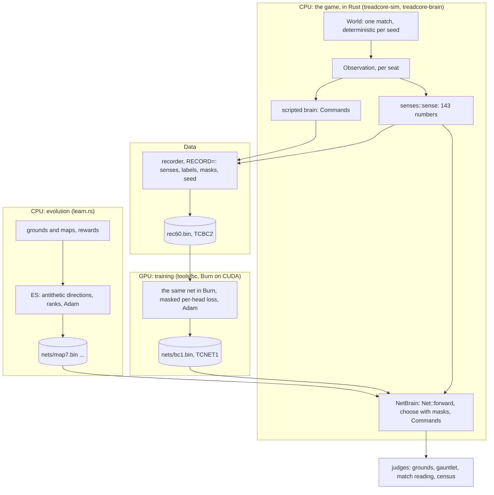

# Training the Learned Tank Anywhere, Playing It in Rust: the Design of the Learning Process

*Lab Report — IEEE Format · 28 October 2026*

Paul Richeson, treadcore.org; Claude Code (Claude Opus 5.5) as the pair.
Companions: `LAB-REPORT-BRAIN.md` sections 95 to 106; `AI-BRAINZ-PLAN.md`;
orrery's `docs/cuda-node-lab-report.md` and `docs/pascal-versions-lab-report.md`.

---

## Abstract

The learned tank is a small net, 143 senses to 42 action scores through two
layers of 64, about 16,000 numbers. It plays the game in plain Rust, on a CPU,
in about 10 microseconds a decision, so a census can play thousands of
matches with it. This report sets out how such a net is to be trained: by
evolution on rewards (on CPUs, built), by imitation of the scripted brain
(on a GPU, being built), and later by reinforcement (PPO); how a Burn program
becomes CUDA kernels on a GTX 1080 Ti; how recorded matches are split into
training and held-out data by seed; which inputs and which rewards are
under the experimenter's control; and the contract that keeps all of it
interchangeable: one definition of the net, computed the same way by the
Rust brain, by a CPU trainer and by a GPU trainer, so that coefficients
trained anywhere play identically in Rust. It ends with a design for
spreading the work over the fleet's CPUs and GPUs and collecting every job's
reports through orrery, with subscribers.

## I. Goal and philosophy

**The goal.** Coefficients for a fast Rust brain. Whatever trains the net,
the product is one file (`nets/NAME.bin`, `Net::save`'s form) that the
plain-Rust `NetBrain` loads and plays. Training may use any hardware;
playing never needs anything but a CPU and the game's own code.

**The rules it inherits** (`CLAUDE.md`, `PROCESS.md`):

1. **The census is the only judge.** A net is better when a team of it reads
   better in the census, outside two standard errors, on one machine. Not
   when its loss falls, not when it imitates well.
2. **The rule before the run.** What would confirm a step is written down
   before the step is run (LR 106 C for this one).
3. **The scripted brain stays the game's brain** until a net beats it by
   rule 1.
4. **Every step recorded**, with its machine, commit and inputs.

**Why a small net.** The census plays 16 seats, five decisions a second,
for 15 minutes, over hundreds of seeds. A net that costs 10 µs a decision
costs a census nothing; one that costs 10 ms costs it everything. So the
shape is fixed small (two layers of 64), and the learning is about what goes
into those 16,000 numbers, not about making the net bigger.

**Three teachers, one student.**

| Teacher | Signal | Where it runs | State |
| --- | --- | --- | --- |
| Evolution strategies (ES) | rewards on training grounds and maps | CPUs (`learn.rs`, `make train`, `make school`) | built; LR 96 to 103 |
| Behaviour cloning (BC) | the scripted brain's choices, as labels | GPU (`tools/bc`, Burn on CUDA) | built; first run in progress (LR 106) |
| Reinforcement (PPO), from the clone | rewards in real matches | GPU for the gradients, CPUs for the matches | planned (AI-BRAINZ-PLAN 8, upgrade 7) |

Cloning gives a starting point that already moves and shoots like a
player; evolution and PPO improve on what imitation cannot teach.

## II. The hierarchy: what runs where



Bottom to top, for one decision of one tank:

1. **The world** (`World::step`, 60 ticks a second) is deterministic per seed
   on one binary.
2. **The observation** is what one seat may know.
3. **The senses** (`senses::sense`) turn it into 143 numbers in fixed places.
4. **The net** turns 143 numbers into 42 scores; **`choose`** takes, in each
   head, the best-scoring choice that is allowed now (the mask); **NetBrain**
   turns the choices into Commands.

## III. The inputs: 143 senses

| Block | Size | What |
| --- | --- | --- |
| Compass | 8 sectors x 11 channels = 88 | for each eighth of the circle around the tank: hostile and friendly tanks, structures, pillboxes, depots, water and other ground, signal strengths falling with distance |
| Body | 12 | armour, shells, reload, speed, the bay's drones, ... |
| Navigation | 6 | home's direction and distance, the route's next step |
| Periscope contacts | 18 | the nearest few contacts' bearings and ranges |
| Hints | 9 | the scripted brain's conclusions (posture, errand): a teacher's notes, meant to be faded out (upgrade 6) |
| Shell contact | 5 | the nearest incoming shell (LR 100) |
| Air contact | 5 | the nearest hostile drone (LR 100) |

Every sense sits in a fixed place, so a weight always means the same thing,
and a net trained on fewer senses is widened with zero weights (`Net::widen`)
and plays as before.

## IV. The outputs, and what the experimenter controls

**Seven heads, 42 scores:** Drive (hold, 8 sectors, stop), Gun (hold, 8
sectors), Lead (the target, its lead point, halfway), Mortar (hold, 8
sectors), Drone (hold, interceptor, recon, strike, longshot), Squad (7, held
until its phase), Signal (hold, 3 calls). NetBrain allows a choice only when
it is possible (a gun sector with a target in reach and a loaded gun), the
**mask**.

**What is under control, by teacher:**

| Teacher | Controls |
| --- | --- |
| ES | the **reward terms** of a training map's `[reward]` table, each a weight: `pass`, `alive`, `damage_taken`, `damage_given`, `killed`, `depot_taken`, `pillbox_taken`, `pillbox_killed`, `closer`, `alive_time`, `armor_gained` (`learn.rs` `REWARDS`); the courses and how they are mixed (rehearsal against forgetting); `PAIRS` (48 antithetic directions), `SIGMA` (0.05), `RATE` (0.02), `DECAY`; the pass rule of each map |
| BC | **no reward**: the labels are the scripted brain's choices. Controlled: the label rules (LR 106 A), which heads are trained, the masks, the matches recorded (seeds, length, the personalities in the seats), epochs, batch, learning rate |
| PPO (planned) | the reward terms again, now in real matches (the census's own score is the natural one, LR 66), and the clone as the starting point |

**A design note on rewards.** Every reward ES has been given is a proxy
written by hand, and LR 97 showed the cost: a net that maximised "reach the
target, shoot it" charged what a match defends and read worse than a random
net in the census. Cloning sidesteps the proxy (the scripted brain is
already decent in matches), and PPO on the census's own score ends it. That
is the order of the plan.

## V. The split by seed

**One seed is one match:** the map, the starts, every random draw. Within
a match, consecutive samples are a fifth of a second apart and nearly the
same. If samples were shuffled and split, the held-out set would hold
near-copies of training samples, and held-out agreement would measure
memory, not learning. **So whole matches are held out:** the recording is
made on seeds 9,000,000 to 9,000,059, and the trainer holds out every sample
of the last tenth of those seeds (9,000,054 to 059). A held-out match is
one the net never saw any moment of, as the census's held-out reads use
seeds no trial was chosen on.

The fleet's seed ranges, kept apart so no reading is made on its own
training data:

| Range | Used for |
| --- | --- |
| 0 to about 6,000,000 | the census and its held-out reads (`make converge` draws its held-out blocks from 4,800,000 and up) |
| 8,000,000 + | the match reading (LR 100) |
| 9,000,000 + | behaviour cloning's recordings (LR 106) |
| a ground's own | training grounds and their 999 held-out grounds |

## VI. How a Burn program becomes CUDA: a tutorial

The trainer is ordinary Rust. Nothing in it is written for CUDA:

```rust
let dev = Device::cuda(0).autodiff();          // the GPU, with gradients
let model = Mlp::new(&dev, 143, 42);           // weights allocated on the GPU
let y = model.forward(x);                      // 3 matmuls, biases, 2 ReLUs
let loss = ...;                                // masked log-softmax per head
let grads = GradientsParams::from_grads(loss.backward(), &model);
model = opt.step(lr, model, grads);            // Adam, on the GPU
```

What happens underneath, layer by layer:

| Layer | Does | On calber |
| --- | --- | --- |
| Burn (`burn` 0.22.1) | tensors and modules; the device chosen at run time | `Device::cuda(0)` |
| Autodiff | records each operation of the forward pass as a graph; `backward()` walks it in reverse to produce gradients | in memory, per step |
| Fusion | merges chains of elementwise operations (add, ReLU, the mask's add) into one kernel | on by default |
| CubeCL (0.11.3) | Burn's kernels, written once in Rust (`#[cube]` functions) for every GPU vendor; matrix multiplication by its own kernels (`cubek`), not cuBLAS | |
| CubeCL's CUDA runtime | translates each kernel to CUDA C++ for the device it finds, and compiles it **at run time** with NVIDIA's runtime compiler (NVRTC, from the CUDA 12.9 toolkit) for `sm_61` | the probe's first run took 4 s, most of it compiling |
| The CUDA driver (580.178.04) | loads the compiled kernels and runs them on the card; memory copies between the CPU and the card | `libcuda`, from Ubuntu's 580-server packages |
| The card | 28 SMs, 11 GB | GTX 1080 Ti, compute 6.1 |

So **"converted into CUDA" means compiled for this card, on this card, the
first time each kernel is needed.** That is why the 1080 Ti works at all
(nothing was precompiled for newer architectures only), and why the toolkit
(NVRTC) is needed on the node as well as the driver.

**One training step on the GPU:** a batch of 4,096 samples is copied to the
card (143 floats each, and the masks and labels); the forward pass is three
matrix products with biases and ReLUs; for each trained head, the head's
slice of the 42 scores plus its mask (0 for allowed, -1e9 for not), a
log-softmax, and the label's log-probability; the sum is the loss; backward
gives every weight's gradient; Adam moves every weight. Only the loss (one
number) comes back to the CPU each step, for the log.

## VII. Parity: the same math on CPU and GPU

**The contract.** One definition of the net, which every implementation must
compute the same way:

| | Definition |
| --- | --- |
| shape | 143 -> 64 -> 64 -> 42 |
| layer | `out[o] = b[o] + sum_i w[o][i] * in[i]`; ReLU after the hidden layers, none after the last |
| layout on disk | `TCNET1`, sizes, then each layer's weights output-major (`w[o * inp + i]`) and biases, f32 little-endian |
| decision | per head, the highest score among the allowed choices (hold always allowed), ties to the lower choice |

**The implementations, and what each is for:**

| | Computes | Trains | Runs on |
| --- | --- | --- | --- |
| `Net::forward` + `choose` (treadcore-brain) | the contract | ES (gradient-free) | any CPU; the game and the census |
| `tools/bc` with `Device::cuda(0)` | the contract, in Burn | BC by gradients | an NVIDIA GPU |
| `tools/bc` with Burn's CPU backend | the same code, `Device::cpu()` or `flex` | BC by gradients | any CPU, no GPU |

The third line is the "CUDA wrapper doing the same math" in reverse: the
same trainer source, its device chosen at run time, runs on a CPU or on the
GPU. So training can be spread over both, and a CPU-only node can train
when the GPU is busy.

**What parity can promise, and what it cannot.** The *math* is the same
everywhere. The *bits* are not: a GPU sums in a different order from a CPU,
and floating-point addition is not associative, so a GPU-trained net and a
CPU-trained one from the same start differ in the last places and drift
apart over steps. That does not matter where it would hurt: **playing is
always `Net::forward` in Rust, deterministic per binary**, so the census
stays exactly reproducible whatever trained the net.

**Parity checks to build** (backlog, LR 107):

1. **Export:** a net trained by `tools/bc`, written, read by `Net::load`, and
   run by `Net::forward` on a thousand recorded senses, gives the same scores
   as Burn's forward on the same inputs, within 1e-4 (the transpose, the
   layout and the activations, checked).
2. **Decision:** `choose` on those scores and the trainer's masked argmax
   pick the same choice on every sample.
3. **Trainer:** the same data, seed and epochs on `Device::cpu()` and
   `Device::cuda(0)` give loss curves within a stated tolerance, and nets that
   pass check 1 against each other.
4. **Masks:** the recorder takes its masks from NetBrain's own
   `gun_target`, `mortar_target` and `launch`, so training and play mask
   alike by construction (built).

## VIII. Spreading the work over CPUs and GPUs

The work is of two kinds, and the fleet has machines for each:

| Work | Bound by | Machines |
| --- | --- | --- |
| playing matches: recording, ES episodes, the census, the gauntlet, match readings | CPU cores, many independent jobs | saskatchewan (24 threads), columbia (8), the Mac (8), calber's CPU (8) |
| gradients: BC now, PPO later | the GPU | calber's 1080 Ti (later the 4060 Ti) |

A training cycle crosses both: CPUs record or play; the GPU trains; CPUs
judge. The files between them are small and self-describing (`TCBC2`
recordings, `TCNET1` nets), so any machine can hand work to any other.

## IX. Collecting the reports: orrery, with subscribers

Every job (a census, a recording, a training run, a gauntlet) already writes
a folder with its settings and logs. What is missing is one place that knows
all of them as they run. The design:

1. **Each job writes a manifest and an event stream** in its folder:
   `job.json` (kind, machine, commit, binary or net hash, inputs, the rule
   it is judged by) and `events.jsonl`, one line an event (`started`,
   `progress` with numbers, `result`, `stopped` with the line that stopped
   it).
2. **Each event is also published** on the Copal fleet's message bus
   (`docs/fleet-plan.md` of copal-alpine-linux; NATS), on a subject such as
   `fleet.jobs.<node>.<kind>.<id>`. An Ubuntu node like calber publishes with
   a small client; a node that cannot reach the bus is pulled over SSH
   instead.
3. **Subscribers** take what they need:
   - **orrery's wall**: every job live, beside the node panels
     (`fleet-status`);
   - **the collector**: archives each finished job's folder on the console
     machine, by machine and commit, never pooling two machines' censuses
     (CENSUS.md 5);
   - **the report writer**: turns results into the lab report's tables;
   - **an alert**: a job that stops tells Paul, with its `STOPPED` line.
4. **The census's ledger** is the first subscriber that exists already
   (`ledger.py --merge`); the others are built the same way.

This is a design; its first piece to build is the event stream in the
recorder and the trainer (LR 107).

## X. Where it stands

| | |
| --- | --- |
| ES on CPUs | built; the school plateaued at round 13 (LR 103, 104) |
| Burn on the GPU | proved (the probe, orrery) |
| BC recorder and trainer | built (`0f7491b`); recorded on calber: 2,490,248 samples from 60 matches of 600 s in 97 s (1.46 GB); training (LR 106) |
| First training run | 12 epochs in 91 s on the 1080 Ti: the first 42 s were reading the 1.46 GB recording and compiling the kernels, then about 4 s an epoch. (A first reading of 42 s an epoch, with the GPU 1% busy, was taken during the load, and was wrong.) Batches are still built on one CPU thread; loading the recording onto the card once is the speed-up when the data grows |
| Parity check 1 | **passed**: Rust's `Net::forward` on the GPU-trained `bc1.bin` agrees with the scripted brain on the held-out samples exactly as the trainer did on the GPU, every head, to the decimal (LR 106 D) |
| The rule | written (LR 106 C) |
| Parity checks 1 to 3, the CPU backend, the event stream | to build (LR 107) |
| PPO | after the clone is judged |

## XI. Discussion

The design turns on one decision: **the net is a file, and only Rust plays
it.** Everything else may change, every trainer, every machine, CPU or GPU,
and the census still reads the same kind of thing the same way. Parity is
then a property to check at one boundary (the file and `Net::forward`), not
a promise every trainer has to keep bit for bit. The teachers are chosen to
cover each other's weakness: evolution needs no gradients but learns slowly
and only what its hand-written rewards say; cloning learns fast but only to
be as good as its teacher; PPO, started from the clone and rewarded by the
census's own score, is the one that can pass the teacher. The census decides
whether it did.
