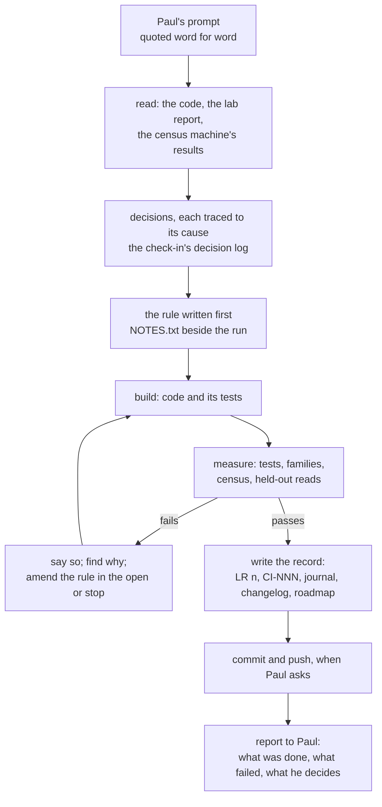
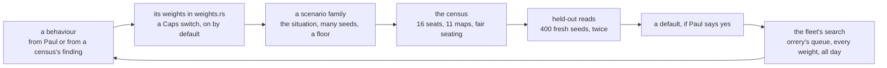

# How treadcore is made

treadcore is MIT open source, and so is the way it was made. This
document describes the process: who does what, how a conversation
becomes a change, how the brain is designed and tested with the
census and scenario families, and where every conversation is kept.
Paul Richeson, with Claude, 26 October 2026, the day of 0.2.0.

Contents: 1. Why the making is part of the source. 2. Two people at
one keyboard. 3. From a prompt to a commit. 4. The record. 5. Designing
the brain by measurement. 6. Fifteen days. 7. What the process caught.
8. Every day from here. 9. Taking part. 10. The pages.

---

## 1. Why the making is part of the source

A game's code says what it does; it does not say why a number is 2 and
not 4, which ideas were tried and dropped, or what a test was meant to
prove before it ran. treadcore keeps all of that beside the code, under
the same licence, so that anyone can:

- read how each decision was reached, from the words that asked for it
  to the measurement that settled it;
- repeat any measurement (every census names its machine, commit,
  seeds and settings);
- see what working with an AI pair looks like on a real project, the
  mistakes included.

## 2. Two people at one keyboard

**Paul** is the author and director. He sets the goals, often in a
sentence typed fast ("teach to network tank to drive and shoot, and
enemy a depot a pillbox"), decides what ships, accepts or refuses every
default change, and owns every outward act that cannot be undone:
publishing to crates.io, publishing a release.

**Claude Code** is the pair (Claude Fable 5.1 on opening day; Claude
Opus 5.5 since). It reads the code and the record, turns a prompt into
decisions, writes the code and the tests, runs the measurements, and
writes the record. Commits are in Paul's name with Claude as
co-author.

The working rules live in `CLAUDE.md`, so that a new session on any
machine resumes the same way. The most important:

| Rule | Why |
| --- | --- |
| One step at a time, synchronously | each step is read before the next is built on it |
| Every step recorded | a lab report section, the roadmap, the changelog, a journal entry, a check-in |
| An either/or is a scalar | a choice becomes a weight the census can read, not an argument |
| Features on by default | a new behaviour is played from the start; the census guards it |
| The rule before the run | what would confirm a change is written down before its census plays |
| Two standard errors is the bar | below that, a difference is noise |
| A default change runs the families (orrery's queue, since LR 112) | a census once passed while a family fell under its floor (CI-044) |
| One machine a census | the sim is deterministic per machine, not across architectures |
| Ask before the irreversible | commits and pushes when Paul asks; a tag only for a release he names; crates.io by Paul, a day after the tag |

## 3. From a prompt to a commit



An example from 26 October. Paul asked for the learned tank to drive
and shoot. The first rule for shooting ("a hit on 95% of grounds") was
read on an untrained net before any training, and the untrained net
passed it, by lobbing mortar shells at a target that never moved. The
rule was amended in the open (`build/train/NOTES.txt`), read again on
the untrained net (44%), and only then trained against. After training
the net passed every ground, and the census of it in real matches read
it worse than a random net. That was reported plainly, with the reason,
and it set the next phase (LAB-REPORT-BRAIN.md section 97).

Paul's prompts are short and sometimes ambiguous. The pair asks only
when a decision is truly his (a default change, a release, what to
spend a night's machine on); otherwise it picks the conventional
reading, says which, and proceeds. When a prompt arrives mid-step, it
is folded into the work in progress rather than queued.

## 4. The record

| Record | What it holds | Where |
| --- | --- | --- |
| Check-in reports | Paul's prompts verbatim; a decision log tracing each decision to its cause, with what was not taken and why; methods to repeat; results with errors; discussion. IEEE form | `documentation/checkins/CI-NNN-*.md`, 57 so far |
| The journal | one entry a session, as a newsgroup post: abstract, chronology, results, open problems, next steps | `journal/`, 102 entries |
| Lab reports | the technical record, a numbered section a step | `documentation/LAB-REPORT-BRAIN.md` (97 sections), `LAB-REPORT.md`, `LAB-REPORT-PACKAGES.md`, ... |
| The roadmap | goals, then a numbered backlog, each item with its cause and state | `documentation/ROADMAP.md` |
| The changelog | what changed, by release | `CHANGELOG.md` |
| Plans and methods | the AI Brainz plan; the census; the brain's map; this document | `documentation/AI-BRAINZ-PLAN.md`, `CENSUS.md`, `BRAIN-MAP.md`, `PROCESS.md` |
| Pages | reports for the web, each a page of the site | `reports/` (section 10) |
| Measurements | each census's settings, seeds, binary and result; each training run's log and rule | `build/` on the machine that ran it; summarised in the lab report |

The conversations themselves are kept as their prompts (in the
check-ins, verbatim) and their consequences (in the decision logs and
the journal). A reader can follow any default in `weights.rs` back to
the census that moved it, the rule written before that census, and the
words that started it.

## 5. Designing the brain by measurement

The scripted brain is a set of behaviours, each with weights. Its
design is a loop of three tests, each a different scale:



**Scenario files and families** (`scenarios/`). A scenario places a
situation and says what must hold: a tank rolling at full speed, a
shell landing within 2.5 tiles of it in 1.5 to 3.5 s from any side;
it must not be hit. A **family** is a scenario whose situation is
drawn from the seed, run over hundreds of seeds against a floor
(`a-rolling-tank-under-a-shell.toml`: 1,000 runs, 99%). A family tests
one behaviour predictably: the same seed is the same situation every
time, and the floor says how often the behaviour must work. `make
families` runs all nine; a default change must keep every floor.

**The census** (`CENSUS.md`). Sixteen seats on every map, the trial
settings in one team's seats against the defaults in the others, each
team taking the trial seat once a seed; the reading is the difference
a seat with its standard error, every map apart. It answers the
question families cannot: does the behaviour win matches.

**Held-out reads.** A census that passes on 55 or 110 seeds is read
twice more on 400 fresh seeds each before it is a candidate, because a
search over many weights finds lucky readings.

**The run** (`make converge` until 28 October; since then the standing
work of orrery's queue on the whole fleet). The census as a learner: every census
in a ledger, each weight's response fit to it, the next trials
suggested, any reading past two errors read held out. It runs until
stopped, and it found dodge_horizon 2 on its own.

**The learned tank** adds a fourth loop with the same shape: a
training ground (a situation drawn from the seed, as a family's), a
reward, held-out grounds with a pass rule, and the census as the last
word (`AI-BRAINZ-PLAN.md`).

## 6. Fifteen days

| Dates | What was built | Journal |
| --- | --- | --- |
| 12 October | the brief; a deterministic world, replay and its hash; the Pillboys; walls and mines; map files; teams and alliances; proposals | 0001 to 0008 |
| 13 October | the defender; prediction; across the Internet; the first playtest; the frame and bezel; six release candidates, packages and the release pipeline; the server; sound; chat; industry under drones | 0009 to 0027 |
| 14 to 15 October | jammers and rookies; tank speak; key setup; the rematch over the network; late arrivals; lobbies, goals and wingmen; fortify; the ladder | 0028 to 0036 |
| 18 October | the brain rebuilt on weights (step 12); the fair census; each switch alone; the posture as scores | 0037 to 0051 |
| 19 to 21 October | what kills half the team; the dodge, measured and planned; SPSA; on by default; a frozen census binary; scenario files and families; every part on and off; supply; the skill dial | 0052 to 0097 |
| 22 to 25 October | a machine for the census; a night on it; reading sooner; the styles ordered | 0098 to 0100 |
| 26 October | the morning read; the census 3 times faster; `make converge`; big-lizard found and fixed; the learned tank designed, built, trained and judged; dodge_horizon 2; release 0.2.0 | 0101 to 0102 |

## 7. What the process caught

Each of these was found by the process, not by luck, and each is in
the record with its fix:

| What | Caught by |
| --- | --- |
| A census passed while a family fell under its floor | the rule that a default change runs `make families` (CI-044) |
| Censuses built from a changing tree read different brains | the frozen census binary (journal 0073) |
| A feature cost on one map only (big-lizard) | the per-map reading; then a probe found why (LR 93) |
| A run that spun 68 generations on failed censuses | a stop after three failures in a row (LR 92) |
| A suspected loss of determinism on x86 | the identity check excludes only timing lines; the diff was a timer |
| Two of phase 3's rules met by an untrained net | reading the rule on the untrained net first (LR 97) |
| A net that forgot one skill while learning another | reading it on the old grounds after training (LR 97) |
| A trained net that is worse in a match | the census of it, against a random net on the same seeds (LR 97) |
| A release check refusing the real game window | the check's own message, then a look at the frame (journal 0102) |

## 8. Every day from here

The fleet runs the search all day and all night from orrery's queue
(`build/queue/grove`), on the newest pushed commit, always reading and
improving the coefficients. The morning read (`CENSUS.md` section 4)
takes what it found: any weight through both held-out reads is a
candidate, its families run by themselves, the strongest can be
prepared as a promotion on a branch, and Paul decides with Approve. A
default change moves `weights.rs`, so the search reads from the new
defaults on.

The learned tank's training follows the same rhythm, with two
commitments from 26 October:

- **Training is designed with the functions.** Every new behaviour of
  the brain ships with its weights, a family that tests it, and a
  training ground with a reward that teaches it, from one scenario
  file. The scripted brain is held to the family's floor; the net is
  trained toward it; both are read on the same situations.
- **Training maps place situations predictably.** A series of
  training scenarios, each putting one situation in front of the tank
  at a place and time the seed draws within set ranges, so a result is
  repeatable and its spread over seeds is a measurement. The series
  and its order are in `AI-BRAINZ-PLAN.md` section 9.

## 9. Taking part

Everything here runs from the repository:

```sh
make test                 # every crate's tests
S=scenarios/x.toml make scenario           # one described situation
TRIAL=a.weights SEEDS=110 scripts/census.sh   # the brain census on this machine
```

Training and measurement on the fleet run from orrery
(`~/code/orrery`, `docs/fleet-train.md`): the census, the families, the
search, the learned tank and the promotions are runs of its queue
(`build/queue/grove`), each a button in its Training view
(LAB-REPORT-BRAIN.md 112 to 116).

A change is proposed the same way the pair works: say what would
confirm it before measuring it (`GOVERNANCE.md` section 5). A census
belongs to one machine; report its machine with its result.

## 10. The pages

Each page is a report of the site (`reports/`, linked from
`index.html`), so it ships with the code under the same licence:

| Page | What |
| --- | --- |
| [Opening day](../reports/2026-10-12-opening-day.html) | the first day: the vision, the research, what was built |
| [The weight ledger](../reports/2026-10-26-the-weight-ledger.html) | every weight: how many over time, every default changed and why, the half-and-double screen, the censuses |
| [The big-lizard map](../reports/2026-10-26-big-lizard.html) | a map drawn from its file, why the route forecast cost there, how it was fixed, four lessons |
| [The learned tank](../reports/2026-10-26-the-learned-tank.html) | the periscope senses to drag, the training curves, the census's verdict |
| [Generations of the learned tank](../reports/2026-10-27-generations.html) | a clip of each generation at work, the gauntlet, real matches, the census, the cost |
